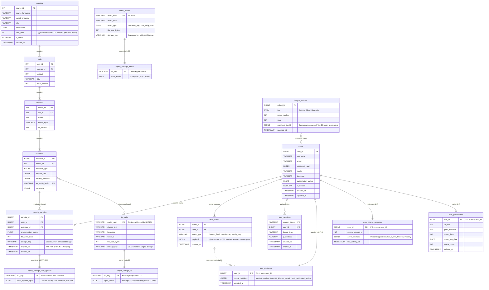

# Расчётно-пояснительная записка для курсовой работы по предмету «Проектирование высоконагруженных систем»

## 1. Тема и целевая аудитория

**Тип сервиса**: мобильная образовательная платформа для изучения языков и других дисциплин (аналог Duolingo).

**Основной функционал MVP**:
1. Регистрация, авторизация и хранение профиля пользователя;
2. Прохождение интерактивных уроков с адаптивной сложностью;
3. Механики удержания (серия дней / streak, XP, уровни, достижения);
4. Прослушивание эталонной речи (нейросетевой синтез речи TTS);
5. Проверка произношения пользователя (speech recognition / phonetic scoring);
6. Обзор и работа над персональными ошибками (Practice Hub);
7. Просмотр каталога курсов и переключение между языковыми парами;
8. Соревновательные механики (еженедельные лиги и лидерборды).

**Ключевые продуктовые и технологические решения**:
1. **Геймификация обучения**: несгораемая серия дней (streak), внутриигровая экономика (gems), соревновательные лиги и лидерборды [[7]](#source7);
2. **Адаптивное обучение и ML в реальном времени**: использование моделей глубокого обучения (Deep Learning) на базе PyTorch для интервального повторения (spaced repetition) и прогнозирования вероятности забывания слов, генерирующих более 300 млн предсказаний в день [[11]](#source11), [[14]](#source14);
3. **Облачная инфраструктура на базе AWS**: применение специализированных GPU-инстансов (в историческом кейсе Duolingo — Amazon EC2 P3 [[14]](#source14); в целевой архитектуре проекта §§7.2, 11 — EC2 G5) для высокопроизводительного ML-инференса и сервиса Amazon Polly для качественного синтеза речи [[10]](#source10), [[14]](#source14);
4. **Кроссплатформенность**: единый масштабируемый бэкенд для мобильных клиентов (iOS, Android) и веб-версии (оптимизация Android-клиента и взаимодействие с глобальным бэкендом — по кейсу [[9]](#source9));
5. **Мультипредметность**: расширение платформы за пределы изучения языков (курсы математики, музыки и шахмат).

**Целевая аудитория**:
* **MAU (Monthly Active Users)**: 133,1 млн уникальных пользователей в месяц (Q4 2025) [[2]](#source2), [[3]](#source3) (отчётность Q4 2025 [[1]](#source1));
* **DAU (Daily Active Users)**: 52,7 млн активных пользователей в день (Q4 2025) [[2]](#source2), [[3]](#source3) (рубеж >50 млн DAU впервые пройден в Q3 2025 [[6]](#source6) и подтверждён по итогам Q4 2025 [[1]](#source1));
* **Total Registered Users (накопленная база аккаунтов, расчётная база §2.3)**: ~600 млн зарегистрированных пользователей за всё время (проектная оценка по открытым публикациям; официально подтверждено >1 млрд загрузок с момента запуска [[4]](#source4), [[8]](#source8));
* **Географическое распределение**: глобальный сервис (Worldwide). По данным Form 10-K около 38% выручки приходится на США (62% — остальной мир, ни одна другая страна не превышает 10%) [[3]](#source3); для моделирования глобального распределения трафика принято проектное разбиение: США ~38%, Европа ~25%, Латинская Америка ~17%, Азиатско-Тихоокеанский регион ~15%, остальной мир ~5%;
* **Демография**: по исторической оценке (архив SQ Magazine, май 2026; удалена в редакции октября 2026 после сверки с отчётностью SEC [[2]](#source2)) более 60% аудитории относили к возрасту 16–34 лет — принято как ориентировочный профиль целевой аудитории.

---

## 2. Продуктовые метрики и расчёт нагрузки

### 2.1 Фактические продуктовые метрики из источников

| Метрика | Значение | Источник / Обоснование |
|---|---|---|
| **Месячная аудитория (MAU)** | 133,1 млн | Годовой отчёт Duolingo Form 10-K и статистика Q4 2025 [[2]](#source2), [[3]](#source3) (финансовые итоги Q4 2025 [[1]](#source1)) |
| **Дневная аудитория (DAU)** | 52,7 млн | Годовой отчёт Duolingo Form 10-K за Q4 2025 [[2]](#source2), [[3]](#source3) (рубеж >50 млн DAU — [[1]](#source1), [[6]](#source6)) |
| **Всего зарегистрированных аккаунтов (Total Users)** | ~600 млн | Проектная база расчёта §2.3 за 12+ лет (официально подтверждено >1 млрд загрузок с момента запуска [[4]](#source4), [[8]](#source8)) |
| **Отношение DAU/MAU (Stickiness ratio)** | 39,6% | $52{,}7 / 133{,}1 \approx 39{,}6\%$ [[3]](#source3). Исключительно высокий показатель удержания для образовательных сервисов: в индустрии EdTech обычно 10–15% [[4]](#source4), [[12]](#source12) |
| **Среднее число сессий на пользователя в день** | 1,85 | Аналитика AppMagic / Udonis [[4]](#source4) |
| **Средняя длительность одной сессии** | 9,58 мин | Аналитика AppMagic / Udonis [[4]](#source4) |
| **Среднее время в приложении в день** | ~17,7 мин | Расчёт по данным AppMagic: 1,85 сессий × 9,58 мин [[4]](#source4) (продуктовый ориентир Duolingo — ≥15 мин/день [[5]](#source5)) |
| **Retention D1** | 37,8% | Аналитика мобильных приложений AppMagic [[4]](#source4); фокус продуктовых команд на удержании (CURR/NURR) как драйвере DAU [[13]](#source13) |
| **Retention D7** | 20,8% | Аналитика мобильных приложений AppMagic [[4]](#source4) |
| **Retention D30** | 12,0% | Аналитика мобильных приложений AppMagic [[4]](#source4) |
| **Retention D365** | 6,8% | Аналитика мобильных приложений AppMagic [[4]](#source4) |
| **Пользователи со стриком ≥ 7 дней** | >50% DAU | Историческая оценка (архив SQ Magazine, май 2026; исключена из [[2]](#source2) в октябре 2026 — принято как допущение) |
| **Объем ML-предсказаний в день** | >300 млн/сутки | Real-time инференс адаптивной сложности в продакшене AWS [[11]](#source11), [[14]](#source14) |

### 2.2 Продуктовые допущения по поведению пользователей в сутки

Все численные параметры ниже приняты как **продуктовые допущения** (при целевом ориентире Duolingo ≥15 мин/день [[5]](#source5)): в модели принято, что типичный урок длится 2,5–3 минуты, за сессию проходится 1–2 урока:

| Действие пользователя | Действий на 1 DAU | Обоснование |
|---|---|---|
| **Завершение урока** | 4 урока | Продуктовое допущение: 1,85 сессий [[4]](#source4) × ~2 урока за сессию |
| **Проверка прогресса и профиля** | 4 раза | Открытие главного экрана, обновление баланса XP/gems |
| **Прослушивание аудиофрагментов (TTS)** | 12 раз | Продуктовое допущение: в среднем 3 аудиофрагмента на урок (использование нейросетевого TTS — [[10]](#source10)) |
| **Выполнение речевых упражнений (голос)** | 3 раза | Продуктовое допущение: ~20–30% упражнений задействуют микрофон (оценка речи на ML — [[14]](#source14)) |
| **Просмотр лидерборда и лиги** | 2 раза | Проверка соревновательного статуса в начале и конце дня |
| **Поиск и просмотр каталога курсов** | 2 раза | Смена активного языка, выбор новых юнитов грамматики |
| **Повторение ошибок (Practice Hub)** | 1 раз | Сессия работы над персонализированными ошибками |
| **Загрузка элементов UI и медиа-ассетов** | 10 элементов | Загрузка иконок, иллюстраций персонажей с Edge CDN |

---

### 2.3 Расчёт нагрузки и технических метрик

#### 2.3.1 Модель и расчёт хранилища данных

Дисковое хранилище делится на:
1. **As-Is объём (статический)** — исходный объём данных на момент запуска;
2. **Динамику прироста (годовую)** — объём новых данных за год эксплуатации.

##### 2.3.1.1 Размеры хранимых структур данных

* **Учетная запись пользователя (users)**: `~0,5 КБ` (auth, настройки, локаль, таймзона, статус подписки, без учета ультра-горячей геймификации);
* **Геймификация и баланс (user_gamification)**: `~100 байт` (user_id, xp_total, gems_balance, streak_days, streak_last_date, updated_at);
* **Денормализованный прогресс по курсам (user_course_progress)**: `~1–2 КБ` на пользователя (1 запись на `user_id` с JSONB-документом активных курсов, уровней и mastery score вместо 50 отдельных строк);
* **Результат пройденного урока (lesson_history / dwh_events)**: `~250 байт` (timestamp, ID урока, набранный XP, затраченное время, массив ошибок);
* **Элемент контента курса**: `~10 КБ` (упражнение, синтаксическое дерево, ответы, метаданные, хэш аудиофайла);
* **Метаданные аудиофрагмента TTS (в БД)**: `~150 байт` (хэш, текст, язык, голос, размер, ключ в S3 `storage_key`). Сам аудиофайл (`~20 КБ`, кодек Opus, 24 kbps mono, 3–5 с) хранится в объектном хранилище S3/MinIO и кэшируется на Edge CDN;
* **Метаданные статических медиа-ассетов (в БД)**: `~150 байт` (хэш, путь, тип, размер, `storage_key`). Файлы иллюстраций и спрайтов (`~50 КБ`) хранятся в объектном хранилище S3 и раздаются через Edge CDN;
* **Речевая запись пользователя (speech_samples)**: метаданные в БД `~200 байт` (sample_id, user_id, exercise_id, score, `storage_key`, TTL). Сам аудиофайл (`~40 КБ`, Opus, 16 kbps mono, 3–4 с) помещается в объектное хранилище S3 (архитектура ML/GPU-инференса и хранения в S3 на AWS — по опыту [[14]](#source14), где исторически применялся EC2 P3; в проекте §§7.2, 11 приняты EC2 G5 и следующие параметры сэмплинга: 99,5% записей оцениваются in-memory на GPU и сбрасываются, а 0,5% сохраняются в S3 для дообучения ML со скользящим TTL = 90 дней по S3 Lifecycle).

##### 2.3.1.2 Статический объём данных (As-Is)

Расчёт ведётся от накопленной базы аккаунтов (Total Users = 600 млн):

| Категория данных | Объём записей / сущностей | Размер записи | Общий объём (ТБ) | Хранилище |
|---|---|---|---|---|
| **Учетные записи (users)** | 600 млн аккаунтов | 0,5 КБ | 0,30 ТБ | RDBMS / NoSQL |
| **Профиль геймификации (user_gamification)** | 600 млн аккаунтов | 0,1 КБ (100 Б) | 0,06 ТБ | In-Memory / Key-Value |
| **Денормализованный прогресс курсов (user_course_progress)** | 600 млн пользователей (1 строка / user) | 1,5 КБ | 0,90 ТБ | Document / NoSQL |
| **Каталог контента всех курсов (exercises, lessons, units, courses)** | 250+ курсов [[2]](#source2), [[3]](#source3) (41 язык [[8]](#source8)) × ~80 тыс. заданий ≈ 20 млн заданий | 10 КБ | 0,20 ТБ | RDBMS / Cache |
| **Метаданные TTS + ассетов в БД** | ~20,2 млн записей метаданных | 0,15 КБ | 0,003 ТБ (~3 ГБ) | RDBMS |
| **Аудиобиблиотека TTS (Pre-rendered, S3)** | ~20 млн уникальных фраз и слов (Amazon Polly) | 20 КБ | 0,40 ТБ | S3 Object Storage + CDN |
| **Статические медиа-ассеты (S3)** | ~200 тыс. иллюстраций персонажей и UI | 50 КБ | 0,01 ТБ | S3 Object Storage + CDN |
| **Накопленная история уроков и DWH-события (архив за 1 год)** | ~77 млрд записей | 250 байт | 19,24 ТБ | ClickHouse / DWH Lake |
| **ML-выборка голосовых записей пользователей (S3, окно 90 дней)** | 52,7 млн DAU × 3 зап/день × 0,005 × 90 дней ≈ 71 млн файлов | 40 КБ | 2,84 ТБ | S3 Object Storage (TTL 90d) |
| **Итого статический объем (As-Is)** | — | — | **~23,95 ТБ** | — |

> **Вывод 1**: За счёт устранения антипаттерна $User \times Course$ (перемножения сущностей) и денормализации прогресса до 1 записи на пользователя (600 млн вместо 30 млрд строк), а также четкого разделения бинарных медиаданных (S3) и метаданных (БД), полезный As-Is объём базы данных сократился, а суммарная полезная ёмкость всех типов хранилищ (БД + DWH + Object Storage) составила **~24 ТБ** (ранее 38,9 ТБ).

##### 2.3.1.3 Динамика прироста данных

1. **История уроков**:
   $$\text{Записей/сутки} = DAU \times \text{уроков/день} = 52{,}7 \times 10^6 \times 4 = 210{,}8 \times 10^6$$
   $$\text{Прирост/сутки} = 210{,}8 \times 10^6 \times 250 \text{ байт} = 52{,}70 \text{ ГБ/сутки}$$
   $$\text{Прирост/год} = 52{,}70 \text{ ГБ} \times 365 \approx 19{,}24 \text{ ТБ/год}$$

2. **Новые пользователи**:
   Накопленная база за 12 лет — 600 млн (~50 млн/год или ~137 тыс./сутки) по 2 КБ:
   $$\text{Прирост/год} = 50 \times 10^6 \times 2 \text{ КБ} = 100 \text{ ГБ/год} = 0{,}10 \text{ ТБ/год}$$
   $$\text{Прирост/сутки} = 100 \text{ ГБ} / 365 \approx 0{,}27 \text{ ГБ/сутки}$$

3. **Прогресс курсов**:
   Активная аудитория генерирует ~20 млн обновлений навыков в сутки по 0,5 КБ:
   $$\text{Прирост/сутки} = 20 \times 10^6 \times 0{,}5 \text{ КБ} = 10{,}00 \text{ ГБ/сутки}$$
   $$\text{Прирост/год} = 10{,}00 \text{ ГБ} \times 365 = 3{,}65 \text{ ТБ/год}$$

4. **Контент курсов и TTS**:
   ~1,5 млн новых заданий и аудиофрагментов в год:
   * Задания: $1{,}5 \times 10^6 \times 10 \text{ КБ} = 15 \text{ ГБ/год}$;
   * Аудио TTS: $1{,}5 \times 10^6 \times 20 \text{ КБ} = 30 \text{ ГБ/год}$;
   $$\text{Прирост/год} = 15 + 30 = 45 \text{ ГБ/год} \approx 0{,}04 \text{ ТБ/год} \quad (0{,}12 \text{ ГБ/сутки})$$

5. **Речевые данные ML**:
   Хранятся в скользящем окне с **TTL = 90 дней** (S3 Lifecycle). Объём стабилизируется на ~2,84 ТБ и постоянного годового прироста не даёт.

| Статья прироста | Формула и расчёт | Прирост в сутки | Прирост в год |
|---|---|---|---|
| **История уроков и упражнений** | 52,7 млн DAU × 4 урока/день × 250 байт | 52,70 ГБ/сутки | 19,24 ТБ/год |
| **Профили новых пользователей** | 50 млн рег./год × 2 КБ ÷ 365 дней | 0,27 ГБ/сутки | 0,10 ТБ/год |
| **Обновление прогресса курсов** | 20 млн обновлений навыков/день × 0,5 КБ | 10,00 ГБ/сутки | 3,65 ТБ/год |
| **Новый контент курсов и TTS** | 1,5 млн заданий × 10 КБ + 1,5 млн TTS × 20 КБ | 0,12 ГБ/сутки | 0,04 ТБ/год |
| **Итого годовой прирост** | $\sum$ всех статей прироста | **~63,09 ГБ/сутки** | **~23,03 ТБ/год** |

> **Вывод 2**: Сервис генерирует **~63,1 ГБ/сутки** полезных данных. Годовой прирост составляет **~23 ТБ** (без учёта фактора репликации).

---

#### 2.3.2 Расчёт нагрузки (RPS) и сетевого трафика

##### 2.3.2.1 Глобальный и локальный пиковые коэффициенты

1. **Глобальный пиковый коэффициент ($K_{peak}^{global} = 1{,}75$)**:
   Аудитория распределена по часовым поясам:
   * США (UTC-5...-8, 38% DAU): пик 00:00–04:00 UTC;
   * Европа (UTC+0...+2, 25% DAU): пик 18:00–22:00 UTC;
   * Латинская Америка (UTC-3...-5, 17% DAU): пик 22:00–02:00 UTC;
   * Азия (UTC+5:30...+9, 15% DAU): пик 13:00–18:00 UTC.
   Взаимное сглаживание региональных пиков даёт глобальный коэффициент $K_{peak}^{global} = 1{,}75$.

2. **Локальный пиковый коэффициент ДЦ ($K_{peak}^{local} = 2{,}8$)**:
   В пределах одного региона пользователи находятся в близких часовых поясах, формируя вечерний пик (19:00–22:00) с локальным коэффициентом $K_{peak}^{local} \approx 2{,}8$.

**Архитектурное следствие**:
* Централизованные хранилища и магистральные каналы рассчитываются по $K_{peak}^{global} = 1{,}75$.
* Вычислительные мощности региональных ДЦ используют автоскейлинг (AWS ASG), масштабируясь под локальный пик $K_{peak}^{local} = 2{,}8$ и снижая ёмкость до 70% ночью.

##### 2.3.2.2 Формулы расчёта

* **Среднесуточный RPS**:
  $$RPS_{avg} = \frac{DAU \times N_{действий}}{86\,400}$$
  *(базовая плотность: $\frac{52{,}7 \times 10^6}{86\,400} \approx 610 \text{ RPS}$ на 1 действие/сутки)*.

* **Пиковый RPS**:
  $$RPS_{peak} = RPS_{avg} \times K_{peak}^{global}$$

* **Сетевая полоса (Мбит/с)**:
  $$\text{Трафик}_{avg} = \frac{RPS_{avg} \times \text{Payload (КБ)} \times 8}{1\,000} \quad [\text{Мбит/с}]$$
  $$\text{Трафик}_{peak} = \frac{RPS_{peak} \times \text{Payload (КБ)} \times 8}{1\,000} \quad [\text{Мбит/с}]$$

---

#### 2.3.3 Единая сводная таблица нагрузки (RPS) и сетевого трафика

| Эндпоинт / Бизнес-сценарий | Тип | Действий на 1 DAU | $RPS_{avg}$ | $K_{peak}^{global}$ | $RPS_{peak}$ | Req / Resp (КБ) | Входящий трафик (Мбит/с) avg / peak | Исходящий трафик (Мбит/с) avg / peak |
|---|---|---|---|---|---|---|---|---|
| `GET /api/v1/lessons/{id}` (получение урока) | API (R) | 4 | 2 440 | 1,75 | 4 270 | 0,2 / 6,0 | 3,9 / 6,8 | 117,1 / 205,0 |
| `POST /api/v1/lessons/{id}/submit` (сдача урока) | API (W) | 4 | 2 440 | 1,75 | 4 270 | 2,0 / 3,0 | 39,0 / 68,3 | 58,6 / 102,5 |
| `GET /api/v1/user/progress` (прогресс и XP) | API (R) | 4 | 2 440 | 1,75 | 4 270 | 0,2 / 2,0 | 3,9 / 6,8 | 39,0 / 68,3 |
| `POST /api/v1/speech/verify` (проверка речи / ML) | ML/API (W) | 3 | 1 830 | 1,75 | 3 203 | 40,0 / 1,5 | 585,6 / 1 025,0 | 22,0 / 38,4 |
| `GET /api/v1/leaderboard` (лидерборд лиги) | API (R) | 2 | 1 220 | 1,75 | 2 135 | 0,2 / 5,0 | 2,0 / 3,4 | 48,8 / 85,4 |
| `GET /api/v1/courses` (каталог и поиск) | API (R) | 2 | 1 220 | 1,75 | 2 135 | 0,3 / 4,0 | 2,9 / 5,1 | 39,0 / 68,3 |
| `GET /api/v1/review/mistakes` (работа над ошибками) | API (R) | 1 | 610 | 1,75 | 1 068 | 0,2 / 3,0 | 1,0 / 1,7 | 14,6 / 25,6 |
| `GET /media/audio/{hash}.opus` (TTS аудио) | CDN (R) | 12 | 7 320 | 1,75 | 12 810 | 0,1 / 20,0 | 5,9 / 10,2 | 1 171,2 / 2 049,6 |
| `GET /static/*` (спрайты, иконки, шрифты) | CDN (R) | 10 | 6 100 | 1,75 | 10 675 | 0,1 / 35,0 | 4,9 / 8,5 | 1 708,0 / 2 989,0 |
| **ИТОГО** | — | — | **25 620** | — | **44 835** | — | **649,1 / 1 135,8 Мбит/с (~0,65 / 1,14 Гбит/с)** | **3 218,3 / 5 632,1 Мбит/с (~3,22 / 5,63 Гбит/с)** |

---

## 3. Глобальная балансировка нагрузки и распределение трафика

### 3.1 Функциональное разбиение по доменам

Разделение по поддоменам изолирует разнородный трафик, обеспечивает cookie-less раздачу медиа и оптимизирует протоколы:

| Домен | Назначение / Эндпоинты | Протоколы | Тип балансировки | Архитектурная изоляция |
|---|---|---|---|---|
| `api.duolingo.com` | Core API: уроки, прогресс, auth, лидерборды | HTTPS (TLS 1.3), HTTP/2, HTTP/3 | GeoDNS / Latency-Based Routing (Route 53) $\to$ Anycast Edge $\to$ Региональный ДЦ | Транзакционная бизнес-логика. Поддержка HTTP/3 (QUIC) защищает мобильных пользователей от обрывов соединений при переключении Wi-Fi/LTE. |
| `speech.duolingo.com` | Проверка речи: `POST /api/v1/speech/verify` | HTTPS, HTTP/2 (gRPC stream), HTTP/3 | Latency-Based Routing (Route 53) $\to$ Выделенный GPU-кластер ДЦ | **Изолирован от Core API**: 1 830 avg / 3 203 peak RPS с тяжелым аудио (40 КБ). Запросы идут напрямую в выделенный GPU-кластер (в проекте §§7.2, 11 — EC2 G5; концепт GPU-инференса на AWS — по опыту [[14]](#source14) с EC2 P3), не забивая очереди основного API. |
| `media.duolingo.com` | Аудиофрагменты TTS: `GET /media/audio/*` | HTTPS, HTTP/2, HTTP/3 | Anycast BGP Edge CDN (CloudFront) [[16]](#source16) | **Cookie-less**: отсутствие заголовков cookie экономит 100+ ГБ трафика в сутки при 7,3k–12,8k RPS. Cache Hit Ratio на Edge > 95%. |
| `static.duolingo.com` | UI-графика, спрайты, шрифты: `GET /static/*` | HTTPS, HTTP/2, HTTP/3 | Anycast BGP Edge CDN (CloudFront) [[16]](#source16) | **Cookie-less**, сжатие Brotli/WebP, разгружает датацентры через 750+ Edge PoP [[16]](#source16). |
| `duolingo.com` | Web-лендинг, маркетинг, SEO | HTTPS, HTTP/2, HTTP/3 | Anycast Edge CDN (CloudFront) $\to$ Web-кластер ДЦ | Статический Jamstack / SSR с кешированием на CDN. |

---

### 3.2 Обоснование выбора и расположения датацентров

#### Влияние задержки на продуктовые метрики
* **Микросессии**: по продуктовому допущению (§2.2) урок длится 2,5–3 мин (10–15 упражнений). При задержке $>300 \text{ мс}$ падает Session Completion Rate.
* **DAU и Retention**: устранение блокировок и снижение задержек на устройствах начального уровня повышает конверсию открытия приложения с 91% до 94,7%, а оптимизация запуска сохраняет ~20 000 пользователей в день [[9]](#source9).
* **Speech ML**: инференс на GPU занимает $\sim 100 \text{ мс}$. Для комфортного диалога ($<200 \text{ мс}$) сетевой RTT должен быть $\le 30–40 \text{ мс}$.

#### Выбор локаций (AWS) [[15]](#source15)
Пять регионов ниже выбраны как проектное решение на базе глобальной инфраструктуры AWS [[15]](#source15) с учётом целевого распределения DAU (§2.3.2.1):
1. **`us-east-1` (США, Вирджиния — Core)**: 27% DAU. Основной регион: мастер-БД, аналитика, S3 Origin.
2. **`us-west-2` (США, Орегон — HA)**: 13% DAU. Обслуживает запад США/Канаду (RTT $<25 \text{ мс}$), Active-Active резерв для `us-east-1`.
3. **`eu-central-1` (Германия, Франкфурт)**: 28% DAU. Хаб Европы (DE-CIX, RTT $<30 \text{ мс}$), соблюдение GDPR.
4. **`sa-east-1` (Бразилия, Сан-Паулу)**: 17% DAU. Снижает RTT в Латинской Америке со $180 \text{ мс}$ (до США) до $<35 \text{ мс}$.
5. **`ap-southeast-1` (Сингапур)**: 15% DAU. Снижает RTT в ЮВА и Индии с $250 \text{ мс}$ (до США) до $<50 \text{ мс}$.
6. **Edge CDN (AWS CloudFront)**: 750+ PoP [[16]](#source16). Раздача статики и TTS с RTT $<15 \text{ мс}$.

---

### 3.3 Расчет распределения запросов по датацентрам

* **CDN (статика + TTS)**: 13 420 avg / 23 485 peak RPS. 95% отдаётся с Edge PoP; 5% Cache Miss ($\approx 671 \text{ avg} / 1 174 \text{ peak RPS}$) идёт на Origin в `us-east-1`.
* **API и Speech ML**: распределяются по региональным ДЦ пропорционально DAU.
* **Локальный пик**: в пределах одного региона $K_{peak}^{local} = 2{,}8$ (глобальный сглаженный пик системы — $1{,}75$).

| Датацентр / Узел | Доля DAU | DAU (млн) | Core API (RPS)<br>avg / local peak ($K=2{,}8$) | Speech ML (RPS)<br>avg / local peak ($K=2{,}8$) | CDN Miss на Origin (RPS) | Трафик In (Мбит/с)<br>avg / local peak | Трафик Out (Мбит/с)<br>avg / local peak |
|---|---|---|---|---|---|---|---|
| **us-east-1** (США, Восток) | 27% | 14,23 | 2 800 / 7 840 | 494 / 1 383 | 671 / 1 174 | 185 / 517 | 228 / 488 |
| **us-west-2** (США, Запад) | 13% | 6,85 | 1 348 / 3 774 | 238 / 666 | 0 (Edge) | 89 / 249 | 41 / 114 |
| **eu-central-1** (Европа) | 28% | 14,76 | 2 904 / 8 131 | 512 / 1 434 | 0 (Edge) | 191 / 536 | 88 / 246 |
| **sa-east-1** (Латин. Америка) | 17% | 8,96 | 1 763 / 4 936 | 311 / 871 | 0 (Edge) | 116 / 325 | 53 / 149 |
| **ap-southeast-1** (Азия / APAC) | 15% | 7,90 | 1 556 / 4 357 | 275 / 770 | 0 (Edge) | 103 / 287 | 47 / 132 |
| **ИТОГО по датацентрам** | **100%** | **52,70** | **10 370 / 29 036\*** | **1 830 / 5 124\*** | **671 / 1 174** | **684 / 1 914\*** | **457 / 1 129\*** |
| **Edge CDN PoPs (750+ узлов)** | — | — | — | — | 13 420 / 23 485 | 11 / 19 | 2 879 / 5 039 |
| **ИТОГО ВСЯ СИСТЕМА** | — | — | **25 620 avg RPS** | — | **44 835 global peak RPS** | **~0,65 / 1,14 Гбит/с** | **~3,22 / 5,63 Гбит/с** |

*\* Примечание*: Сумма локальных пиков серверов в регионах ($K=2{,}8$) выше одновременного глобального пика ($K=1{,}75$), так как часы пик в США, Европе и Азии разнесены во времени.

---

### 3.4 Схема DNS балансировки (GSLB) для прикладных сервисов (API)

Для динамических сервисов (**Core API** и **Speech ML**) применяется DNS-балансировка (GSLB) на базе **Amazon Route 53** с поддержкой EDNS Client Subnet (ECS, RFC 7871) [[17]](#source17) и маршрутизацией на Unicast IP датацентров [[18]](#source18).

```
Клиент (App / Web)
   │
   ▼ 1. DNS-запрос A-записи api.duolingo.com с ECS (RFC 7871)
[AWS Route 53 Anycast DNS] ── Проверка Health Checks (/healthz каждые 10 с)
   │
   ├─► LBR (минимальный RTT: Европа)  ──► Unicast IP [eu-central-1] (Франкфурт)
   ├─► LBR (минимальный RTT: США)     ──► Unicast IP [us-east-1] (Вирджиния)
   ├─► LBR (минимальный RTT: Латин.)  ──► Unicast IP [sa-east-1] (Сан-Паулу)
   └─► LBR (минимальный RTT: Азия)    ──► Unicast IP [ap-southeast-1] (Сингапур)
         │
         └─ (При 3 сбоях подряд = 30 с: DNS Failover переключает на резервный ЦОД)
```

1. **Latency-Based Routing (LBR)**: Route 53 направляет клиента в датацентр с минимальным RTT.
2. **Health Checks & Failover**: опрос эндпоинта `/healthz` каждые 10 с. При 3 сбоях подряд (30 с) аварийный ДЦ выводится из ротации.
3. **TTL записей**:
   * Динамический API (`api.duolingo.com`, `speech.duolingo.com`): $\text{TTL} = 60 \text{ с}$;
   * Статические ресурсы (`media.duolingo.com`): $\text{TTL} = 86\,400 \text{ с}$ (24 ч).

---

### 3.5 Схема Anycast балансировки

Anycast используется на уровне глобальной сети AWS (CloudFront [[16]](#source16), Route 53). Для бэкендов API Anycast напрямую не применяется, чтобы исключить риски BGP flapping между датацентрами.

```
[Пользователь]
     │ 
     ▼ Anycast IP (анонсируется по BGP из 750+ точек Edge PoP)
[Ближайший AWS Edge PoP] (Франкфурт, Варшава, Токио, Сан-Паулу и др. — RTT 5-15 мс)
     │
     ├─► 1. DNS-резолвер Route 53 (Anycast): мгновенный ответ на DNS за 2–5 мс
     ├─► 2. CloudFront CDN: Cache HIT (95% TTS аудио и картинок) ──► Мгновенная отдача
     ├─► 3. Терминация TLS 1.3 / TCP: быстрый Handshake на границе (5–15 мс)
     │
     ▼ 4. Только при Cache Miss или динамическом проксировании
[AWS Global Private Backbone] (внутренняя выделенная оптика AWS без джиттера)
     │
     ▼
[Целевой региональный датацентр] (us-east-1, eu-central-1 и др.)
```

1. **Anycast DNS**: авторитетные серверы Route 53 отвечают через Anycast BGP на ближайшем PoP за 2–5 мс.
2. **Edge TLS Termination**: рукопожатие TLS 1.3 происходит на ближайшем Edge PoP за 5–15 мс (вместо 150–200 мс через океан).
3. **Кэширование медиа (CDN)**: >85% исходящего трафика (TTS Opus и графика) отдаётся из памяти и NVMe-дисков пограничных узлов с Cache Hit > 95%.
4. **DDoS Protection (Anycast Sinkholing)**: L3/L4 атаки рассеиваются сетью пограничных PoP AWS, не перегружая каналы региональных ДЦ.

---

### 3.6 Механизм регулировки трафика между датацентрами

```
[BGP Anycast Routing]  ──(оперативно, 5-15 с)──>  BGP AS-Path Prepending / Withdrawal
          ▲
[Route 53 DNS GSLB]    ──(плавно, 30-60 с)─────>  Weighted Routing (WRR) / DNS Failover
          ▲
[Мобильный клиент]     ──(локально на клиенте)─>  Exponential Backoff + SQLite кэш
```

1. **DNS-балансировка (Route 53)** [[18]](#source18):
   * **Weighted Round Robin (WRR)**: плавное перераспределение долей трафика при плановых работах ($100\% \to 75\% \to 50\% \to 0\%$). Сходимость — **30–60 с** (по TTL).
   * **Route 53 Failover**: вывод аварийного ДЦ при сбое проверок `/healthz` (30 с).
2. **Anycast BGP**:
   * **BGP AS-Path Prepending**: искусственное удлинение маршрута к перегруженному региону. Время сходимости — **5–15 с**.
   * **BGP Withdrawal**: отзыв анонса маршрута при полной недоступности региона.
3. **Клиентская защита**:
   * **Exponential Backoff with Jitter**: защита от шторма повторных запросов (Thundering Herd) при переключениях.
   * **Локальный кэш уроков (SQLite)**: офлайн-доступность уроков и сохранение прогресса на диске при сбоях сети (подход к офлайн-работе и локальной записи прогресса — по кейсу [[9]](#source9); выбор SQLite — проектное решение).

#### Матрица отказоустойчивости (Failover Matrix)

| Пострадавший ДЦ | Резервный ДЦ | Добавочный RTT | Добавочный API RPS | Запас емкости резервного ДЦ |
|---|---|---|---|---|
| **us-east-1** (27%) | `us-west-2` (Орегон) | $+50 \text{ мс}$ | $+2\,800 \text{ avg} / +7\,840 \text{ peak}$ | $+70\%$ (Active-Active пара) |
| **us-west-2** (13%) | `us-east-1` (Вирджиния) | $+50 \text{ мс}$ | $+1\,348 \text{ avg} / +3\,774 \text{ peak}$ | $+25\%$ |
| **eu-central-1** (28%) | `us-east-1` (Вирджиния) | $+75 \text{ мс}$ | $+2\,904 \text{ avg} / +8\,131 \text{ peak}$ | $+35\%$ (пики не накладываются из-за 6 ч разницы поясов) |
| **sa-east-1** (17%) | `us-east-1` (Вирджиния) | $+110 \text{ мс}$ | $+1\,763 \text{ avg} / +4\,936 \text{ peak}$ | $+25\%$ |
| **ap-southeast-1** (15%) | `eu-central-1` (Франкфурт) | $+90 \text{ мс}$ | $+1\,556 \text{ avg} / +4\,357 \text{ peak}$ | $+20\%$ |

---

## 4. Локальная балансировка нагрузки

### 4.1 Схема балансировки и уровни резервирования

Внутри каждого регионального датацентра используется двухуровневая схема обработки входящего трафика (North-South) и распределенная клиентская балансировка для межсервисных вызовов (East-West) [[19]](#source19), [[20]](#source20):

```
[ Входящий трафик (Route 53 / Anycast) ]
                  │
                  ▼
┌──────────────────────────────────────────────────────────────┐
│ 1. L4-уровень: LVS в режиме Direct Routing (DSR)              │
│    • BGP ECMP на свитчах распределяет пакеты на L4-ноды      │
│    • LVS подменяет Dst MAC на MAC-адрес L7-сервера           │
│    • Обратный трафик уходит клиенту НАПРЯМУЮ через шлюз ДЦ   │
│    • Формула резервирования: N + 1 (Active-Active)           │
└──────────────────────────────┬───────────────────────────────┘
                               │ Входящие запросы
                               ▼
┌──────────────────────────────────────────────────────────────┐
│ 2. L7-уровень: Nginx / Envoy Cluster                         │
│    • SSL Termination (TLS 1.3), буферизация медленных клиентов│
│    • Балансировка HTTP/2 запросов, маршрутизация по URI      │
│    • Формула резервирования: N + 1                           │
└──────────────────────────────┬───────────────────────────────┘
                               │ gRPC / REST (Keep-Alive)
                               ▼
┌──────────────────────────────────────────────────────────────┐
│ 3. Межсервисный уровень (East-West): Envoy Sidecar Proxy     │
│    • Service Discovery через Kubernetes API / CoreDNS        │
│    • По-запросная (per-request) балансировка gRPC стримов    │
│    • Circuit Breaker и Outlier Detection (выброс сбоящих)    │
│    • Формула резервирования подов: N + 2                     │
└──────────────────────────────────────────────────────────────┘
```

#### Обоснование выбранных решений:
* **Входящий L4 (LVS-DR)**: В режиме Direct Routing (DSR) входящий трафик проходит через L4, а «тяжелый» обратный трафик (ответы API, медиа) уходит клиенту напрямую через шлюз датацентра, минуя L4-балансировщик. Это полностью исключает узкое горлышко по процессору и сетевой полосе самого L4-балансировщика (в отличие от L4 NAT, где балансер тратит CPU на трансляцию адресов каждого исходящего пакета) [[19]](#source19).
* **Входящий L7 (Nginx / Envoy)**: Централизованно снимает нагрузку по шифрованию TLS с бэкендов, буферизует запросы от медленных мобильных клиентов (особенно аудиозаписи 40 КБ при проверке речи) в оперативную память и разбирает мультиплексированные потоки HTTP/2.
* **Межсервисный L7 (Envoy Sidecar в Kubernetes)**: Для протокола gRPC обычный балансировщик L4 бесполезен (все RPC-вызовы шли бы по одному открытому TCP-соединению на один под). Envoy Sidecar на стороне клиента парсит HTTP/2 фреймы и балансирует каждый RPC-вызов индивидуально, исключая лишний сетевой узел (no extra hop) [[20]](#source20).

---

### 4.2 Отказоустойчивость и механизмы резервирования

| Уровень | Решение | Как работает резервирование | Поведение при сбое | Формула |
|---|---|---|---|---|
| **L4 (Сеть)** | BGP ECMP + keepalived | Пул L4-нод анонсирует один VIP по BGP. keepalived следит за доступностью L7 | При падении L4-ноды BGP исключает её за $<1 \text{ с}$. Трафик делится между живыми нодами | **$N + 1$** |
| **L7 (Прокси)** | Nginx Active Upstream | `proxy_next_upstream error timeout http_502 http_503;` | При сбое пода запрос мгновенно повторяется на соседний (таймаут 150–500 мс, макс. 2 попытки) | **$N + 1$** |
| **East-West** | Envoy Outlier Detection | Пассивный мониторинг ответов подов | 3 ошибки 5xx подряд $\to$ под исключается из маршрутизации на 30 с | **$N + 2$** (автоскейл) |

---

### 4.3 Расчёт нагрузки по терминации SSL (TLS Termination)

* **Исходные данные**:
  * Пиковый RPS в крупнейшем регионе (`us-east-1`): **10 397 RPS** (Core API + Speech ML + Origin CDN Miss).
  * Коэффициент повторного использования Keep-Alive: 1 новое TLS-соединение на 10 запросов $\to$ **$\text{CPS}_{peak} \approx 1\,040$ handshake/сек**.
  * Структура рукопожатий:
    * **Full Handshake (15%)**: 156 шт/с (обмен ключами ECDHE на эллиптических кривых X25519).
    * **Resumed Handshake (85%)**: 884 шт/с (быстрое возобновление сессий через Session Tickets RFC 5077 / TLS 1.3 PSK).
* **Производительность 1 ядра современного CPU (с аппаратным AES-NI)**:
  * Full TLS 1.3: $\sim 2\,000$ handshake/сек.
  * Resumed TLS: $\sim 20\,000$ handshake/сек.
  * Симметричное шифрование (AES-GCM): $\sim 1\,500$ МБ/с ($\approx 12$ Гбит/с).
* **Потребность в CPU для TLS в пике (`us-east-1`)**:
  $$N_{CPU}^{Full} = \frac{156}{2\,000} \approx 0{,}08 \text{ ядра}$$
  $$N_{CPU}^{Resumed} = \frac{884}{20\,000} \approx 0{,}04 \text{ ядра}$$
  $$N_{CPU}^{Bulk} = \frac{126 \text{ МБ/с}}{1\,500 \text{ МБ/с}} \approx 0{,}08 \text{ ядра}$$
  $$\mathbf{N_{CPU}^{SSL} \approx 0{,}2 \text{ ядра}}$$

> **Вывод**: На современном процессоре TLS обходится в копейки

---

### 4.4 Расчёт необходимого числа балансировщиков

#### Ограничители и сайзинг:
1. **L4-узел**: 1 сервер LVS обрабатывает $>2$ млн пак/сек и 10 Гбит/с! Наш пик - 50 тыс. пак/сек (517мбит/с / 1 400 кбайт = 46 160 пакетов). Нам хватило бы 1 сервера, но для отказоустойчивости ставится **2 сервера ($N+1$) в каждый ДЦ**.
2. **L7-узел**: Типовой инстанс **8 vCPU, 16 ГБ RAM, сеть 12.5 Гбит/с** (AWS `c6i.2xlarge`).
   * 1 vCPU держит $1\,200$ HTTPS RPS при целевой безопасной загрузке CPU $60\%$.
   * Емкость 1 сервера L7: $8 \times 1\,200 = \mathbf{9\,600 \text{ RPS}}$.
   * Память: 50 000 параллельных соединений требуют $\sim 2{,}5$ ГБ RAM (в 16 ГБ укладывается с большим запасом).

#### Сводная таблица балансировщиков по регионам

| Датацентр / Регион | Пик RPS ДЦ | Пик In / Out (Мбит/с) | SSL CPS | Расчёт L7 ($N_{req}$) | Формула резерва L7 | Итого L7 нод (8 vCPU) | Итого L4 нод (LVS, N+1) | Нагрузка L7 нод в пике |
|---|---|---|---|---|---|---|---|---|
| **us-east-1** (США, Восток) | 10 397 | 517 / 488 | 1 040 | 2 | $N + 1$ | **3** | **2** | 36% (при отказе 1 ноды: 54%) |
| **eu-central-1** (Европа) | 9 565 | 536 / 246 | 957 | 1 | $N + 2$ | **3** | **2** | 33% (при отказе 1 ноды: 50%) |
| **sa-east-1** (Латин. Америка) | 5 807 | 325 / 149 | 581 | 1 | $N + 1$ | **2** | **2** | 30% (при отказе 1 ноды: 60%) |
| **ap-southeast-1** (Азия / APAC) | 5 127 | 287 / 132 | 513 | 1 | $N + 1$ | **2** | **2** | 27% (при отказе 1 ноды: 53%) |
| **us-west-2** (США, Запад) | 4 440 | 249 / 114 | 444 | 1 | $N + 1$ | **2** | **2** | 23% (при отказе 1 ноды: 46%) |
| **ИТОГО** | **35 334\*** | **1 914 / 1 129\*** | **3 535** | **6** | — | **12** | **10** | — |

*\* Примечание: сумма пиков по регионам учитывает разницу часовых поясов ($K_{peak}^{local} = 2{,}8$). При аварии `us-east-1` и переключении в `us-west-2` автоскейлинг (ASG) поднимает L7 в Орегоне до 4 нод.*

---

## 5. Логическая схема данных

### 5.1 Концептуальная архитектура и ER-диаграмма

В схеме данных исключены реляционная сверхнормализация (3NF) и антипаттерн прямого перемножения сущностей ($User \times Item$):
1. **Изоляция горячих данных геймификации**: Часто обновляемые поля (XP, gems, стрик) отделены от «холодного» учетного профиля (`users`) в сущность `user_gamification`. Это предотвращает деградацию и сбои сервиса авторизации при пиковых нагрузках на геймификацию и позволяет вынести последнюю в специализированное In-Memory / Key-Value хранилище.
2. **Денормализация прогресса курсов**: Вместо плоской таблицы связки на 30 млрд строк `(user_id, course_id)` прогресс хранится по принципу «одна запись на пользователя» (`user_course_progress`) с вложенным документом активных курсов (`active_courses: JSONB`). Это снизило количество строк с 30 млрд до 600 млн.
3. **Контур DWH и аналитических событий (`dwh_events`)**: Добавлено хранилище потока событий (клики, завершение уроков, промежуточные ответы, брошенные сессии, аудио-интеракции), служащее единым источником данных для ML-моделей адаптивной сложности, Spaced Repetition и рекомендательных выборок.
4. **Адаптивное обучение и персональные ошибки (`user_mistakes`)**: Применен паттерн персонального среза (Dual Indexing) — per-user хранилище активных проблемных упражнений (`recent_mistakes: JSONB`), формируемое асинхронно / near-line процессами из DWH, без создания миллиардов связующих строк $User \times Exercise$.
5. **Четкое разделение метаданных и объектного хранилища (S3 / Object Storage)**: В таблицах базы данных исключены любые бинарные блобы (`BYTES *_blob`). БД хранит исключительно компактные метаданные (`storage_key`, размер, кодек, score, TTL), а бинарные файлы (TTS-аудио, медиа-спрайты, аудиозаписи пользователей) размещаются в распределенном объектном хранилище (S3/MinIO) с кэшированием статики на Edge CDN и lifecycle-политикой TTL = 90 дней для пользовательской речи.
6. **Денормализация когорт лидербордов (`league_cohorts`)**: Соревновательные лиги формируются изолированными когортами (комнатами) по ~30 пользователей (`cohort_id`), где турнирная таблица хранится целиком внутри документа когорты (`members_top30: JSONB`).



---

### 5.2 Описание полей и назначение сущностей

| Сущность | Назначение и архитектурная роль | Ключевые поля |
|---|---|---|
| **users** | **Холодный учетный профиль**: аутентификация, паспортные данные и настройки. Избавлен от высокочастотных апдейтов геймификации. Мягкое удаление (`is_deleted`) вместо физического `DELETE`. | `user_id` (PK), `email` (UQ), `password_hash`, `subscription_status`, `locale`, `timezone`, `is_deleted`, `created_at`, `updated_at` |
| **user_gamification** | **Ультра-горячий профиль геймификации** (1:1 к `user_id`). Принимает частые инкременты при завершении каждого урока. Изолирован от auth-сервиса (может размещаться в Key-Value / In-Memory хранилище). | `user_id` (PK, FK → users), `xp_total`, `gems_balance`, `streak_days`, `streak_last_date`, `hearts_count`, `updated_at` |
| **user_course_progress** | **Денормализованный прогресс по курсам** (1 строка на пользователя). Избавление от антипаттерна $User \times Course$. Хранит компактный JSONB-документ со списком всех активных языков, текущих юнитов и mastery-баллов. | `user_id` (PK, FK → users), `current_course_id`, `active_courses` (JSONB), `last_activity_at` |
| **user_mistakes** | **Персональный срез ошибок** для Practice Hub и Spaced Repetition (1:1 к `user_id`). Формируется асинхронно из DWH; хранит массив недавних проблемных упражнений и рассчитанные ML вероятности забывания. | `user_id` (PK, FK → users), `recent_mistakes` (JSONB), `updated_at` |
| **courses** | **Каталог курсов** (языковые пары и дисциплины). Поле `total_units` зафиксировано как денормализованный счетчик для избежания дорогого `COUNT(*)` при read-heavy нагрузке. | `course_id` (PK), `source_language`, `target_language`, `title`, `total_units` (денормализовано), `is_active` |
| **units** | Юниты (тематические разделы) курса. Справочные immutable-данные. | `unit_id` (PK), `course_id` (FK → courses), `ordinal`, `title`, `total_lessons` |
| **lessons** | Уроки внутри юнита (микросессии на 2,5–3 минуты). | `lesson_id` (PK), `unit_id` (FK → units), `ordinal`, `lesson_type`, `xp_reward` |
| **exercises** | Упражнения урока: синтаксическое дерево задания, варианты, правильные ответы, ссылка на метаданные TTS. | `exercise_id` (PK), `lesson_id` (FK → lessons), `exercise_type`, `content_tree` (JSONB), `correct_answers` (JSONB), `tts_audio_hash` (FK) |
| **league_cohorts** | **Денормализованная когорта лиги** (комната на ~30 пользователей). Вместо реляционной связки N:M хранит массив участников с их еженедельным XP в JSONB-структуре `members_top30`. | `cohort_id` (PK), `tier`, `week_number`, `year`, `members_top30` (JSONB), `updated_at` |
| **dwh_events** | **Поток событий DWH (Event Store)**: append-only лог событий (клики, завершение уроков, промежуточные ответы, прослушивания). Источник данных для ML, рекомендаций и аналитики. | `event_id` (PK), `user_id` (FK), `event_type`, `payload` (JSONB), `created_at` |
| **tts_audio** | **Метаданные синтезированной речи** (Amazon Polly). Хранит только ссылку `storage_key` на объект в S3, хэш текста и размер. Бинарные файлы в БД отсутствуют! | `audio_hash` (PK, SHA256), `phrase_text`, `language`, `voice_id`, `file_size_bytes`, `storage_key` |
| **static_assets** | **Метаданные статических UI-ассетов** (иллюстрации персонажей Duo, векторная графика, WebP/SVG). Содержит путь и `storage_key` для раздачи через Edge CDN. | `asset_hash` (PK, SHA256), `asset_path`, `asset_type`, `file_size_bytes`, `storage_key` |
| **speech_samples** | **Метаданные ML-выборки речевых записей пользователей** (0,5% записей для дообучения). Хранит `storage_key` в S3 и срок жизни `expires_at` (скользящее окно TTL = 90 дней). | `sample_id` (PK), `user_id` (FK), `exercise_id` (FK), `pronunciation_score`, `storage_key`, `expires_at`, `created_at` |
| **user_sessions** | Сессии авторизации и кэш токенов аутентификации. | `session_token` (PK), `user_id` (FK), `device_type`, `ip_address`, `expires_at` |
| **object_storage_*** | **Контур объектного хранилища (S3 / MinIO)**: физическое хранение блобов аудио TTS, медиа-спрайтов и аудиозаписей пользователей. Вынесен за пределы СУБД. | `s3_key` (PK), бинарное содержимое (Opus / WebP / SVG) |

---

### 5.3 Размеры данных, нагрузка на чтение/запись, консистентность и распределение ключей

> Все расчёты согласованы с продуктовыми метриками (DAU = 52,7 млн, Total Users = 600 млн, базовая плотность = 610 RPS на 1 действие/DAU/сутки).
> За счёт выноса блобов в S3 и денормализации прогресса курсов (с 30 млрд до 600 млн строк) реляционная база избавлена от раздувания.

| Сущность | Кол-во строк / объектов | Размер строки | Общий объём | QPS чтение (avg / peak) | QPS запись (avg / peak) | Требования к консистентности | Распределение нагрузки по ключам |
|---|---|---|---|---|---|---|---|
| **users** | 600 млн | ~0,5 КБ | 0,30 ТБ | 2 440 / 4 270 | ~1,6 / 2,8 (только auth/reg/settings) | **Strong** — аутентификация и безопасность | Ключ `user_id`. Равномерное шардирование, холодных данных много |
| **user_gamification** | 600 млн | ~0,1 КБ (100 Б) | 0,06 ТБ | 2 440 / 4 270 | 2 440 / 4 270 | **Strong** — инкремент XP, защита от накруток | Ключ `user_id`. Горячая запись при сдаче уроков. Размещается в In-Memory / Key-Value |
| **user_course_progress** | 600 млн *(1 на user)* | ~1,5 КБ | 0,90 ТБ | 2 440 / 4 270 | 2 440 / 4 270 | **Strong** — разблокировка уроков | Ключ `user_id`. Денормализованный JSONB сократил объем с 30 млрд строк до 600 млн |
| **user_mistakes** | 600 млн *(1 на user)* | ~0,5 КБ | 0,30 ТБ | 610 / 1 068 | ~100 RPS (batch near-line) | **Eventual** — аналитический срез | Ключ `user_id`. Формируется асинхронно из DWH для Practice Hub |
| **courses** | ~250+ | ~1 КБ | ~0,3 МБ | 1 220 / 2 135 | ~0 | **Eventual** — справочные данные | Ключ `course_id`. Денормализован `total_units`. 100% помещается в кэш |
| **units** | ~20 тыс. | ~0,2 КБ | ~4 МБ | Совместно с courses | ~0 | **Eventual** — справочные данные | Ключ `unit_id`. Горячие: базовые юниты популярных курсов |
| **lessons** | ~500 тыс. | ~0,3 КБ | ~150 МБ | 2 440 / 4 270 | ~0 | **Eventual** — кэшируется клиентом | Ключ `lesson_id`. Zipf-распределение по популярности |
| **exercises** | 20 млн | ~10 КБ | 0,20 ТБ | 2 440 / 4 270 | ~0 | **Eventual** — immutable при релизе | Ключ `exercise_id`, вторичный индекс по `lesson_id` |
| **league_cohorts** | ~1,76 млн комнат/нед | ~3 КБ (Top-30) | ~5,3 ГБ | 1 220 / 2 135 | 2 440 / 4 270 (в кэш) | **Eventual** — допустимо отставание 5–10 с | Ключ `cohort_id`. 30 пользователей в одном документе; запись амортизируется кэшем |
| **dwh_events** | ~77 млрд + 210,8 млн/сут | ~250 байт | 19,24 ТБ (+19,24 ТБ/год) | ~50 RPS (ML/DWH) | 2 440 / 4 270 (append-only) | **Eventual** — поток событий | Партиционирование по дате (`created_at`) и `user_id`. ClickHouse / Data Lake |
| **tts_audio (метаданные)** | ~20 млн записей | ~150 байт | ~3 ГБ | 7 320 / 12 810 (CDN 95% → Origin ~366) | ~17 RPS | **Eventual** — immutable по SHA256 | Ключ `audio_hash`. Бинарники вынесены в S3 (`object_storage_tts`) |
| **static_assets (метаданные)**| ~200 тыс. записей | ~150 байт | ~30 МБ | 6 100 / 10 675 (CDN 95% → Origin ~305) | ~0 | **Eventual** — immutable по SHA256 | Ключ `asset_hash`. Бинарники вынесены в S3 (`object_storage_media`) |
| **speech_samples (метаданные)**| ~71 млн (окно 90 дней)| ~200 байт | ~14,2 ГБ | ~10 RPS (batch ML) | ~9 RPS (0,5% выборки) | **Eventual** — скользящий TTL 90d | Ключ `sample_id`. Бинарники в S3 (`object_storage_user_speech`) с S3 Lifecycle TTL |
| **user_sessions** *(кэш)* | ~80 млн активных | ~0,3 КБ | ~24 ГБ (in-memory) | 25 620 / 44 835 | ~1 580 / 2 765 | **Strong** — отзыв токена при logout | Ключ `session_token`. In-memory Redis кластер |
| **S3: TTS Audio** | ~20 млн файлов | ~20 КБ | 0,40 ТБ | 7 320 / 12 810 (CDN) | ~17 RPS | **Eventual** — объектное хранилище | S3 Key = `audio_hash.opus`. Раздача через CloudFront |
| **S3: Static Assets** | ~200 тыс. файлов | ~50 КБ | 0,01 ТБ | 6 100 / 10 675 (CDN) | ~0 | **Eventual** — объектное хранилище | S3 Key = `asset_hash.ext`. Раздача через CloudFront |
| **S3: User Speech Samples** | ~71 млн файлов | ~40 КБ | 2,84 ТБ | ~10 RPS (ML batch) | ~9 RPS | **Eventual** — S3 Lifecycle TTL = 90d | S3 Key = `sample_id.opus`. Автоудаление через 90 дней |

---

### 5.4 Кэши и буферы

| Кэш / Буфер | Хранимые данные | Объём (in-memory) | QPS чтение | QPS запись / инвалидация | TTL | Консистентность |
|---|---|---|---|---|---|---|
| **Session Cache** | `session_token → user_id`, device, expiry | ~24 ГБ (80 млн × 0,3 КБ) | 25 620 / 44 835 | 1 580 / 2 765 | 30 дней | **Strong** — немедленная инвалидация при logout / смене пароля |
| **Gamification Cache** (`user_gamification_cache`) | Горячие поля: `xp_total`, `gems_balance`, `streak_days`, `hearts` | ~6 ГБ (52,7 млн DAU × 0,1 КБ) | 2 440 / 4 270 | 2 440 / 4 270 (write-through) | 24 часа (+ write-through) | **Strong** — мгновенный отклик при начислении XP / списании жизней |
| **Leaderboard Cohort Cache** | Актуальный Top-30 для активных когорт лиг (~1,76 млн комнат) | ~5,3 ГБ (1,76 млн комнат × 3 КБ) | 1 220 / 2 135 | Пакетный flush каждые 5–10 с | 10 сек | **Eventual** — амортизирует частые обновления очков пользователей |
| **User Course Progress Cache** | Денормализованный прогресс активного курса пользователя | ~26 ГБ (52,7 млн DAU × 0,5 КБ активного среза) | 2 440 / 4 270 | 2 440 / 4 270 (write-behind / write-through) | 2 часа | **Strong** — защита от откатов прогресса прохождения |
| **Course Content Cache** | Сериализованные деревья уроков и упражнений | ~2 ГБ (горячие 20% от 200 ГБ контента) | 2 440 / 4 270 | ~0 (инвалидация при публикации контента) | 1 час (+ invalidate on publish) | **Eventual** — справочный неизменяемый контент |
| **ML Audio Buffer (Inference)** | Временный буфер аудио в RAM/GPU-очереди до распознавания речи | ~3 ГБ (3 203 RPS × 40 КБ × 30 с окно) | — | 1 830 / 3 203 (enqueue) | Drain ≤ 200 мс | **At-most-once** — 99,5% записей сбрасываются сразу после scoring |
| **DWH Event Streaming Buffer** | Буфер сообщений (Apache Kafka) перед загрузкой в ClickHouse/DWH | ~2 ГБ (буфер на 15–30 сек потока аналитики) | — | 2 440 / 4 270 | Пакетный сброс (batch 5 с) | **At-least-once** — надежная доставка аналитики и ошибок |
| **CDN Edge Cache** | Аудиозаписи TTS + статические медиа-ассеты (WebP/SVG) | Распределён по 750+ Edge PoP [[16]](#source16) (~500 ГБ суммарно) | 13 420 / 23 485 | Push при деплое ассетов / генерации TTS | 24 часа (TTS), 7 дней (статика) | **Eventual** — неизменяемы по content hash |

---

## 6. Физическая схема данных

### 6.1 Выбор СУБД по профилю нагрузки

| Группа данных | Профиль нагрузки | Выбранная СУБД | Альтернатива | Архитектурное обоснование выбора |
|---|---|---|---|---|
| **users**, **контент курсов** (`courses`, `units`, `lessons`, `exercises`, метаданные TTS/ассетов) | **Read-Heavy / OLTP**:<br>• `users`: Write 2,8 peak RPS, Read 4 270 peak RPS. Объем 300 ГБ.<br>• Контент: 205 ГБ, Read 4 270 peak RPS (90% отсекает L7-кэш). | **PostgreSQL 18** | MySQL 8.4, MongoDB | • Требуется строгая целостность (ACID), уникальность email/username и поддержка `JSONB` с GIN-индексами для синтаксических деревьев заданий.<br>• В PostgreSQL 18 оптимизировано управление соединениями и ускорена работа с JSONB.<br>• **Отказ от шардирования**: 300 ГБ `users` и 205 ГБ контента полностью укладываются в лимит безопасного размера узла (< 1 ТБ) и обслуживаются кластером с репликами. |
| **user_course_progress**, **user_mistakes**, **speech_samples** | **Write-Heavy / NoSQL**:<br>Запись 4 270 peak RPS, Чтение 4 270 peak RPS. Объем 1,22 ТБ (+3,65 ТБ/год). Доступ строго по `user_id`. | **ScyllaDB 2026** | Apache Cassandra 5.0 | • Запись в LSM-дерево (MemTable $\to$ CommitLog) оптимизирована под частые апдейты без распределенного консенсуса.<br>• **ScyllaDB (C++, Seastar framework)** использует архитектуру **Thread-per-Core (Shared-Nothing)**: каждый поток CPU привязан к ядру и собственному участку памяти.<br>• *В отличие от Cassandra на Java*, отсутствуют паузы сборщика мусора (Stop-the-World GC) и блокировки потоков ОС, гарантируя предсказуемый SLA (p99 $< 5 \text{ мс}$).<br>• Query-first: выборка прогресса за 1 раундтрип по ключу `user_id`. |
| **user_sessions**, **user_gamification**, **league_cohorts** | **Ultra-Hot In-Memory**:<br>Сессии: 44 835 peak RPS. Геймификация: 4 270 peak RPS. SLA $< 1 \text{ мс}$. | **Redis 8.10 / Valkey 9.1** | Memcached, Tarantool | • Нативные структуры: `STRING` с TTL для сессий, `HASH` (`HINCRBY`) для инкремента XP/стрика без блокировок, `ZSET` для Top-30 лиги за $O(\log N + M)$.<br>• Персистентность: AOF `appendfsync everysec` (потери при аварии $\le 1$ с) + RDB-снапшоты.<br>• Вытеснение: `volatile-lru` для сессий, `noeviction` для геймификации. |
| **dwh_events** | **Append-Only / OLAP**:<br>4 270 peak RPS (210 млн/сут), объем 19,2 ТБ/год полезных данных. | **ClickHouse 26.9** (+ Kafka) | PostgreSQL, Druid | • Колоночное сжатие (LZ4/ZSTD) уменьшает объем в $4\times$ (19,2 ТБ $\to$ ~4,8 ТБ на диске). Векторный движок (SIMD) ускоряет агрегации продуктовых воронок и Spaced Repetition.<br>• Запись пакетами по 20k–50k строк через топик Kafka исключает фрагментацию партов. |
| **courses_search_index** (поиск по каталогу: `courses`, `units`) | **Full-Text Search**:<br>Read 2 135 peak RPS. Объем индекса ~50 ГБ. | **OpenSearch 3.9** | Postgres `tsvector` | • Специализированный Inverted Index (BM25) с нечетким поиском и стеммингом. Изолирует поиск от базы транзакций. |
| Блобы медиа и речи (`object_storage_*`) | **BLOB Storage**:<br>TTS (0,4 ТБ), графика (0,01 ТБ), речь (2,84 ТБ с TTL 90d). | **SeaweedFS / S3** | NFS, GridFS | • S3 — протокол объектного хранилища, а не база данных. SeaweedFS предоставляет S3-совместимый API «из коробки», без отдельного шлюза. S3 Lifecycle удаляет записи речи через 90 дней. |

---

### 6.2 Физическая структура хранения и индексы

#### Сводная таблица хранения сущностей

| Сущность | Хранилище | Ключ доступа (PK / Shard Key) | Индексы и структуры | Объем данных |
|---|---|---|---|---|
| **users** | PostgreSQL 18 (Users DB) | `user_id` (BIGINT, PK) | • B-Tree: `email` (UNIQUE)<br>• B-Tree: `username` (UNIQUE) | ~300 ГБ (600 млн строк) |
| **courses**, **units**, **lessons** | PostgreSQL 18 (Content DB) | `course_id`, `unit_id`, `lesson_id` (PK) | • B-Tree Composite: `units(course_id, ordinal)`<br>• B-Tree Composite: `lessons(unit_id, ordinal)` | ~155 МБ суммарно |
| **exercises** | PostgreSQL 18 (Content DB) | `exercise_id` (BIGINT, PK) | • B-Tree: `lesson_id`<br>• GIN-индекс: `metadata` (JSONB) | ~200 ГБ (20 млн строк) |
| **tts_audio**, **static_assets** | PostgreSQL 18 (Content DB) | `audio_hash` / `asset_hash` (PK) | • B-Tree по PK (SHA256 хеш)<br>• `storage_key` указывает на S3 | ~3 ГБ (метаданные) |
| **user_course_progress** | ScyllaDB 2026 | Partition Key: `user_id` | • Данные: `active_courses` (JSON текст)<br>• LSM-дерево + Bloom Filter | ~900 ГБ (600 млн строк) |
| **user_mistakes** | ScyllaDB 2026 | Partition Key: `user_id` | • Данные: `recent_mistakes` (JSON текст)<br>• Compaction: Leveled | ~300 ГБ (600 млн строк) |
| **speech_samples** | ScyllaDB 2026 | `PRIMARY KEY ((user_id), sample_id)` | • Clustering Key: `sample_id` (DESC)<br>• Нативный TTL: 90 дней (7 776 000 с) | ~14,2 ГБ (71 млн строк) |
| **user_sessions** | Redis 8.10 Cluster | Key: `sess:{token}` | • Тип: `STRING`, TTL: 30 дней<br>• Hash-доступ $O(1)$ | ~24 ГБ RAM (80 млн токенов) |
| **user_gamification** | Redis 8.10 Cluster | Key: `user:{id}:gamif` | • Тип: `HASH` (`xp`, `gems`, `streak`, `hearts`)<br>• Атомарный `HINCRBY` | ~6 ГБ RAM (52,7 млн DAU) |
| **league_cohorts** | Redis 8.10 Cluster | Key: `league:{cohort_id}:board` | • Тип: `ZSET` (`score` = XP, `member` = `user_id`)<br>• Выборка Top-30: $O(\log N + 30)$ | ~5,3 ГБ RAM (1,76 млн комнат) |
| **dwh_events** | ClickHouse 26.9 | Shard: `user_id`<br>OrderBy: `(event_type, event_date, user_id, event_id)` | • Движок: `ReplicatedMergeTree`<br>• Партиционирование: `toYYYYMM(event_date)`<br>• Типы: `LowCardinality(String)` | 19,2 ТБ/год (raw) $\to$ 4,8 ТБ/год (сжатый) |
| **courses_search_index** | OpenSearch 3.9 | Index Doc ID: `course_id` | • Inverted Index (BM25), n-gram, fuzzy search<br>• Денормализованный документ: `courses`, `units` | ~50 ГБ (с репликами) |

#### Индексы и структуры данных

```
1. B-Tree / B+Tree (Postgres):
   • Точечный поиск: users(email) -> O(log N)
   • Диапазоны и сортировка: units(course_id, ordinal) -> Leftmost Prefix Rule (поиск по course_id или course_id+ordinal)

2. Hash Table (Redis):
   • O(1) поиск по сессионному токену и доступ к полям геймификации

3. Inverted Index (OpenSearch):
   • Терм -> [DocID_1, DocID_2, ...] с оценкой релевантности BM25 для поиска курсов и упражнений

4. Bloom Filter (ScyllaDB / ClickHouse):
   • Битовый массив в RAM, отсекающий до 95% холодных обращений к диску для отсутствующих ключей
```

---

### 6.3 Шардирование и партиционирование

#### 1. Почему PostgreSQL НЕ шардируется
* Объем таблицы `users`: 600 млн строк $\times 0{,}5 \text{ КБ} = \mathbf{300 \text{ ГБ}}$.
* Объем таблиц контента (`courses`, `units`, `lessons`, `exercises`): $\mathbf{\sim 205 \text{ ГБ}}$.
* Нагрузка на запись в `users`: **2,8 peak RPS** (только регистрация/смена пароля).
* **Архитектурное решение**: Шардирование таблиц размером в 200–300 ГБ с единичной интенсивностью записи — это неоправданный оверинжиниринг. Лимит безопасного размера базы данных на один узел Postgres без деградации VACUUM составляет $\approx 1 \text{ ТБ}$. Данные разделены на два независимых кластера (**Users DB** на 300 ГБ и **Content DB** на 205 ГБ). Каждый кластер состоит из 1 Master + 2 Replicas, а чтение масштабируется репликами и L7-кэшем.

#### 2. Шардирование ScyllaDB 2026 (`user_course_progress`, `user_mistakes`)
* **Механизм**: Автоматическое распределение по кольцу консистентного хеширования (Consistent Hashing).
* **Shard Key (Partition Key)**: **`user_id`**.
* Хеш-функция `Murmur3` отображает `user_id` в пространство токенов ($0 \dots 2^{64}-1$). Каждая физическая нода владеет пулом виртуальных нод (256 vnodes), обеспечивая равномерное распределение 1,22 ТБ данных без перекосов (hot spots).

#### 3. Шардирование Redis 8.10 Cluster
* Хеш-слоты: 16 384 слота распределены поровну между master-нодами кластера.
* Привязка ключа: `CRC16(key) mod 16384`. Использование Hash Tags (например, `{user:123}:gamif`) гарантирует локализацию связанных данных одного пользователя в пределах одного слота.

#### 4. Шардирование и партиционирование ClickHouse 26.9
* **Шардирование**: 2 шарда по 2 реплики (`ReplicatedMergeTree`), запись распределяется по `cityHash64(user_id)`.
* **Партиционирование**: помесячное `PARTITION BY toYYYYMM(event_date)`. Удаление устаревших данных за пределами retention-окна выполняется мгновенно на уровне метаданных: `ALTER TABLE dwh_events DROP PARTITION '202401'`.

---

### 6.4 Отказоустойчивость, репликация и консистентность

| Хранилище | Модель репликации | Фактор (RF) | Кворум / Консенсус | RPO / RTO | Поведение при отказе узла |
|---|---|---|---|---|---|
| **PostgreSQL 18 (Users DB)** | Master + 2 Replicas (1 Sync + 1 Async) | 3 | **Patroni + etcd** (Raft) | $\text{RPO} = 0$<br>$\text{RTO} < 15 \text{ с}$ | Синхронная реплика гарантирует zero data loss. При сбое мастера Patroni автоматически промоутит реплику за $<15$ с. |
| **PostgreSQL 18 (Content DB)** | 1 Master + 2 Read Replicas | 3 | Patroni + etcd | $\text{RPO} = 0$<br>$\text{RTO} < 15 \text{ с}$ | При аварии мастера чтение продолжается с реплик; промоут резервного мастера занимает $<15$ с. |
| **ScyllaDB 2026 (Progress)** | Multi-AZ кольцо токенов | $\text{RF} = 3$ | **`LOCAL_QUORUM`** ($W=2, R=2$) | $\text{RPO} = 0$<br>$\text{RTO} = 0 \text{ с}$ | **$R + W > N$ ($2 + 2 = 4 > 3$)** — строгое выполнение кворума. При падении 1 ноды чтение и запись продолжаются без прерывания обслуживания. |
| **Redis 8.10 Cluster** | Master-Replica per Slot ($N+1$) | 2 (1M + 1R) | Встроенный консенсус нод | $\text{RPO} \le 1 \text{ с}$<br>$\text{RTO} < 3 \text{ с}$ | Реплика автоматически перехватывает слоты мастера за 2–3 секунды. |
| **ClickHouse 26.9** | 2 шарда $\times$ 2 реплики | 2 | **ClickHouse Keeper** (Raft) | $\text{RPO} \approx 0$<br>$\text{RTO} < 5 \text{ с}$ | Запись буферизуется в Kafka (3 брокера, $RF=3$). Реплики ClickHouse читают из топика независимо. |
| **SeaweedFS / S3 (Storage)** | Erasure Coding 8+4 | $1{,}5\times$ overhead | Встроенный механизм размещения | $\text{RPO} = 0$<br>$\text{RTO} = 0 \text{ с}$ | Сохраняет доступность при одновременном выходе из строя нескольких volume-нод. |

---

### 6.5 Расчет ресурсов и спецификация оборудования

> Итоговый сайзинг с учётом разбиения кластеров по владельцам (§10.2), выбор оборудования, хостинга и месячная стоимость — **§11**.

#### Методика расчета:
* **Дисковая емкость**: $\text{Disk} = \frac{\text{Raw Data} \times RF \times 1{,}3 \text{ (индексы/WAL)} \times 1{,}3 \text{ (compaction/reserve)}}{0{,}70 \text{ (порог заполнения SSD)}} \approx \text{Raw} \times RF \times 2{,}4$.
* **RAM**: 100% сессий, геймификации, контента и $\ge 20\%$ активного профиля пользователей в буферном пуле.
* **CPU / IOPS**: Обработка локального пика ($K_{peak}^{local} = 2{,}8$) с резервированием $N+1$ и утилизацией процессоров в пике не более $40\%$.

#### Спецификация серверного парка баз данных

| Сервисный кластер | Нод | CPU на ноду (всего) | RAM на ноду (всего) | Диски на ноду | Пиковая нагрузка (RPS / IOPS) | Запас емкости и резервирование |
|---|---|---|---|---|---|---|
| **PostgreSQL Users DB** | **3** (1M + 2R) | 8 vCPU (24) | 64 ГБ (192 ГБ) | $2 \times 1$ ТБ NVMe RAID-1 | 4 270 Read / 2,8 Write RPS | 300 ГБ данных + 100 ГБ индексов. Working set в RAM. Резерв $N+2$. |
| **PostgreSQL Content DB** | **3** (1M + 2R) | 8 vCPU (24) | 128 ГБ (384 ГБ) | $2 \times 1$ ТБ NVMe RAID-1 | 4 270 Read RPS (90% отсекает кэш $\to$ 430 RPS) | Весь контент (205 ГБ) помещается в RAM. Резерв $N+2$. |
| **ScyllaDB Cluster** | **3** (кольцо RF=3) | 16 vCPU (48) | 64 ГБ (192 ГБ) | $2 \times 1{,}92$ ТБ NVMe (Direct I/O) | 4 270 Read + 4 270 Write RPS ($\approx 17\text{k}$ ops/s с кворумом) | Суммарно 11,5 ТБ NVMe (требуется 7,8 ТБ). Кластер тянет $>180\text{k}$ IOPS. Пик CPU $< 15\%$. Резерв: выдерживает потерю 1 ноды. |
| **Redis Cluster** | **6** (3M + 3R) | 4 vCPU (24) | 16 ГБ (96 ГБ) | 100 ГБ SSD (AOF/RDB) | 44 835 Read / 4 270 Write RPS ($\approx 15\text{k}$ RPS на master) | 35,3 ГБ данных в 96 ГБ RAM. 1 инстанс держит до 60k RPS. Резерв $N+1$. |
| **ClickHouse Cluster** | **4** (2 шарда $\times$ 2R) | 16 vCPU (64) | 64 ГБ (256 ГБ) | $2 \times 3{,}84$ ТБ NVMe RAID-1 | 4 270 RPS (пакетный flush из Kafka по 20k–50k строк) | 15,3 ТБ полезного места хватает на >2 года аналитики сжатием $4\times$. |
| **OpenSearch Cluster** | **3** (Master/Data) | 8 vCPU (24) | 32 ГБ (96 ГБ) | 500 ГБ NVMe | 2 135 Search RPS | Индекс (50 ГБ) в системном дисковом кэше. Резерв $N+1$. |
| **ИТОГО** | **22 ноды** | **208 vCPU** | **1 216 ГБ RAM** | **~32 ТБ NVMe/SSD** | **Пик: 44,8k RPS** | **Отказоустойчивость: N+1 / N+2 на всех уровнях** |

---

### 6.6 Пороги масштабирования

| Слой / Хранилище | Текущее значение | Триггер | Следующий шаг |
|---|---|---|---|
| **PostgreSQL Users DB** | 300 ГБ | > 700 ГБ | Вертикальный апгрейд → read-реплика → шардирование через Citus по `user_id` |
| **PostgreSQL Content DB** | 200 ГБ | > 600 ГБ | Вынос `content_tree` / `correct_answers` в document store (ScyllaDB / MongoDB) |
| **ScyllaDB** | 1,22 ТБ / 3 ноды | > 2 ТБ на ноду | Добавить 3 ноды (RF=3 сохраняется, vnodes перебалансируют данные автоматически) |
| **Redis Cluster** | 35,3 ГБ / 3 master | > 60 ГБ | Добавить master-pair; «холодных» пользователей (>30 дней) вытеснять в ScyllaDB |
| **ClickHouse dwh_events** | ~4,8 ТБ/год (сжатый) | > 10 ТБ на шард | Добавить 3-й шард; установить `TTL event_date + INTERVAL 2 YEAR`; агрегировать в materialized view |
| **SeaweedFS / S3 (объектное)** | ~3,25 ТБ | > 80% ёмкости | Добавить volume-сервера; TTS и статика не растут критично — основной рост от сэмплов речи при росте DAU |
| **L7-балансировщики** | 33–36% CPU в пике | > 60% CPU устойчиво | ASG поднимает дополнительную ноду; при x2 DAU увеличить baseline с `N+1` до `N+2` |

---

## 7. Описание алгоритмов функционирования блоков системы

Два ключевых алгоритма, определяющих профиль нагрузки на CPU/GPU, структуру хранения и сквозную задержку (SLA):
1. **Half-Life Regression (HLR)** — адаптивное интервальное повторение в условиях нагрузки $>300$ млн прогнозов в сутки;
2. **Conformer-CTC + Goodness of Pronunciation (GoP)** — потоковый конвейер оценки устной речи на GPU с жестким ограничением по времени (SLA $< 200$ мс) и фильтрацией 99,5% медиапотока.

---

### 7.1 Адаптивное интервальное повторение на базе Half-Life Regression (HLR)

* **Наименование алгоритма**: Half-Life Regression (HLR) для моделирования динамики забывания информации.
* **Блок системы**: Подсистема адаптивного обучения и генерации уроков (*Practice Hub / Adaptive Learning Engine*).
* **Постановка задачи**: Прогнозирование вероятности успешного вспоминания $p$ изученной лексемы через интервал $\Delta t$ после последнего повторения и ранжирование упражнений с целью удержания сложности в оптимуме ($p \in [0{,}75; 0{,}85]$).
* **Исходные данные и ограничения**:
  * *Вход*: `user_id`, история повторений лексемы (число успехов $n^+$, ошибок $n^-$, прошедшее время $\Delta t$), лингвистические параметры слова (длина, часть речи).
  * *Ограничения*: онлайн-инференс формирования урока $\le 25$ мс (p99); объем инференса $>300$ млн вызовов/сутки; пиковый RPS на сервис повторения — 1 068 RPS.
  * *Результат*: отранжированный список из 10–15 упражнений.
* **Последовательность работы алгоритма (Offline + Online)**:
  * *Математическая модель*: Закон Эббингауза $p = 2^{-\frac{\Delta t}{h}}$, где период полураспада памяти $h$ моделируется регрессией $\log_2 h = \boldsymbol{\theta}^T \mathbf{x} = \sum w_i x_i + b$.
  * *Оффлайн-контур*:
    1. ClickHouse (`dwh_events`): сбор лога попыток (210 млн записей/сутки);
    2. Раз в сутки Spark/PyTorch переобучает вектор весов $\boldsymbol{\theta}$ минимизацией MSE с $L_2$-регуляризацией;
    3. Веса $\boldsymbol{\theta}$ экспортируются в Feature Store (Redis/ScyllaDB).
  * *Онлайн-контур*:
    1. Запрос `GET /api/v1/review/mistakes` $\to$ из ScyllaDB (`user_mistakes`) за 1 раундтрип ($<2$ мс) извлекаются до 100 проблемных лексем пользователя;
    2. Вычисление $h = 2^{\boldsymbol{\theta}^T \mathbf{x}}$ и $p = 2^{-\Delta t / h}$ на CPU воркера через SIMD/AVX2 ($\approx 1{,}2$ мс на весь пул кандидатов);
    3. Фильтрация: отсечение $p > 0{,}92$ (слишком просто) и $p < 0{,}40$ (требует повтора теории);
    4. Top-K отбор 12 заданий через ограниченную кучу (Min-Heap) по функции асимметричного штрафа (Two-Piece Normalized Loss):
       $$L(p) = \begin{cases} 
       \left(\dfrac{0{,}80 - p}{0{,}40}\right)^2, & p \le 0{,}80 \quad (\text{риск забывания}) \\[6pt]
       \left(\dfrac{p - 0{,}80}{0{,}12}\right)^2, & p > 0{,}80 \quad (\text{переобучение / потеря времени})
       \end{cases}$$
       *Обоснование асимметрии*: окно $[0{,}40; 0{,}92]$ несимметрично относительно оптимума $p^* = 0{,}80$ (левое плечо $\Delta_L = 0{,}40$, правое $\Delta_R = 0{,}12$). Симметричная метрика $|p - 0{,}80|$ приводила к «голоданию» (starvation) слов с $p \in [0{,}40; 0{,}68)$ (отклонение $> 0{,}12$) — они вытеснялись почти освоенными словами ($p \approx 0{,}90$). Нормирование по ширине плеча дает $L(0{,}40) = L(0{,}92) = 1{,}0$ и крутизну штрафа справа в $\approx 11{,}1$ раз выше, гарантируя приоритет актуальным словам на грани забывания.
* **Используемые структуры данных**:
  * Вектор признаков контакта $\mathbf{x} \in \mathbb{R}^D$ (Sparse Float32);
  * Денормализованный JSONB-документ `user_mistakes` в ScyllaDB по ключу `user_id`;
  * Min-Heap (очередь с приоритетом) на 15 элементов для онлайн-ранжирования.
* **Рассматриваемые альтернативы**:
  * *Алгоритм Leitner / SM-2 (Anki)*: дискретные фиксированные интервалы, эвристические коэффициенты, нет учета контекста и морфологии;
  * *Deep Knowledge Tracing (DKT на LSTM/Transformers)*: высокая точность, но неприемлемая вычислительная сложность $O(L \cdot d^2)$ на GPU при 300+ млн запросов в сутки;
  * *Выбранный HLR*: баланс между учетом психометрической кривой памяти и скоростью линейной регрессии ($O(d)$ на CPU, $<2$ мс).
* **Обоснование выбора**: HLR вычисляется элементарными операциями на CPU серверов приложений, не требует GPU для онлайна и обеспечивает детерминированный SLA $< 25$ мс при нулевых затратах на специализированное железо.
* **Влияние на архитектуру и БД**:
  * Определило денормализацию `user_mistakes` в ScyllaDB (1 строка на пользователя вместо 30 млрд строк $User \times Lexeme$);
  * Изоляция: модель учится оффлайн на ClickHouse, онлайн-инференс не создает блокировок и очередей в транзакционной базе.

---

### 7.2 Конвейер потоковой оценки произношения (Speech Scoring Pipeline)
**Алгоритм:** Goodness of Pronunciation (GoP) поверх Conformer-CTC с принудительным
выравниванием (Витерби).
**Блок:** Speech Verification Service, изолированный GPU-контур `speech.duolingo.com` (§3.1), TensorRT FP16 на EC2 G5.

#### Постановка задачи

Пользователь произносит **заранее известную** фразу упражнения. Нужно за ≤ 200 мс
(E2E) выдать оценку `score ∈ [0; 1]`, флаг зачёта и подсветку проблемных фонем/слов.
Нагрузка: 3 203 RPS в глобальном пике (до 5 124 по сумме локальных), вход ~1 Гбит/с.

Ключевая идея: текст ответа известен → это **не распознавание речи**, а проверка
«насколько акустика похожа на эталонную цепочку фонем». Поэтому декодер текста не
нужен вовсе — достаточно покадровых вероятностей фонем.

#### Как работает алгоритм

**Оффлайн:** G2P-словарь превращает все фразы курса в цепочки фонем (хранится в Trie);
Conformer-CTC (~30 млн параметров) обучается на многоязычном корпусе и экспортируется
в TensorRT FP16.

**Онлайн (один запрос):**

1. Декодирование Opus → PCM (~2 мс) и лог-мел спектрограмма (~3 мс), CPU.
2. Один forward-pass модели на GPU (~65 мс). Выход — матрица `A[t, q]`:
   вероятность каждой фонемы `q` на каждом кадре `t` (~100 кадров для 4 с аудио).
3. **Forced Alignment:** алгоритм Витерби ищет по матрице монотонный путь строго
   по эталонной цепочке фонем → границы `[t_s, t_e]` каждого звука. O(T·L) ≈ 4 000
   операций, доли мс на CPU.
4. **GoP** для каждой фонемы — «эталон против лучшего конкурента»:

$$GoP(p) = \frac{1}{t_e - t_s + 1} \sum_{t=t_s}^{t_e} \Bigl[ \log P(p \mid \mathbf{x}_t) - \log \max_{q} P(q \mid \mathbf{x}_t) \Bigr]$$

Если произнесли правильный звук — модель уверена именно в нём, GoP ≈ 0. Если
другой — максимум берётся по конкуренту, GoP сильно отрицательный. Считается из
**той же матрицы**, второй прогон GPU не нужен.

5. Калибровка сигмоидой (пороги подобраны оффлайн на размеченном корпусе):
   score фонемы ∈ [0; 1]; score слова = минимум по фонемам (одно плохое слово
   «краснеет» целиком); score фразы = взвешенное среднее. Зачёт при score ≥ 0.6.

#### Бюджет задержки (p99)

| Этап | Время |
| --- | --- |
| Opus + спектрограмма (CPU) | 5 мс |
| Ожидание слота батча (batch ≤ 32, окно 10 мс) | ≤ 10 мс |
| Forward Conformer-CTC (GPU) | 65 мс |
| Витерби + GoP + калибровка + JSON (CPU) | 18 мс |
| **Сервер итого** | **≤ 98 мс** |
| + сеть (региональный ДЦ) | 30–40 мс |
| **E2E** | **≤ 140–160 мс** ✅ (SLA 200 мс) |

Никаких синхронных записей на диск: ответ отдаётся сразу, аудио живёт только
в ring buffer в RAM.

#### Управление хранением: sampling 0,5%

После скоринга случайный сэмплер решает: **99,5%** аудио уничтожается в RAM;
**0,5%** (~9 RPS) уходит в Kafka, после воркер переносит в хранилище
#### Сайзинг GPU

65 мс на батч ≤ 32 → потолок ~490 req/s на A10G; с запасом ×0,6 принимаем
**300 RPS/GPU**. Потребность: 5 124 / 300 ≈ 17 GPU
#### Альтернативы

| Вариант | Почему нет |
| --- | --- |
| Облачные ASR API | >$950k/мес, RTT 600–1500 мс, нет пофонемного GoP |
| Whisper (авторегрессия) | 250–500 мс на генерацию текста, который и так известен |
| Крупный wav2vec 2.0 | Не укладывается в 65 мс → парк GPU ×5 |

Conformer-CTC + GoP: один параллельный проход (SLA), фонемные вероятности бесплатно
(GoP без второго инференса), компактная модель (цена), ошибки видны до фонемы (продукт).

* **Влияние на архитектуру и БД**:
  * Выделение отдельного домена `speech.duolingo.com` изолирует поток 1 Гбит/с от Core API;
  * Фильтрация 99,5% записей в памяти снижает нагрузку на запись в S3 с 1 830 RPS до **9 RPS**, стабилизируя объем хранилища речи на отметке 2,84 ТБ вместо 568 ТБ/год;
  * Таблица `speech_samples` в ScyllaDB хранит только метаданные отобранных сэмплов с нативным TTL 90 дней.

---

## 8. Технологический стек проекта

| Категория / Домен | Назначение / решаемая проблема | Выбранная технология | Альтернативы | Обоснование выбора |
|---|---|---|---|---|
| **Клиент: Mobile** | Единая бизнес-логика, нативный UI и работа с микрофоном. | **Kotlin Multiplatform (KMP)** | React Native, Flutter | Нативный доступ к аудио-буферам без лагов GC и оверхеда JS-моста. |
| **Клиент: Web** | Веб-интерфейс с интерактивным UI уроков. | **TypeScript + React** | Vue.js, Svelte | Зрелая экосистема, богатый выбор UI-библиотек и простота найма. |
| **Бэкенд: Core Services** | Stateless микросервисы API (Gateway, Progress, Content). | **Go (Golang)** | Java (Spring Boot), C++ | Высокая плотность горутин при минимальном потреблении RAM (~25 МБ/инстанс) и быстрый запуск. |
| **Бэкенд: ML Inference** | Конвейер инференса Conformer-CTC и расчет GoP. | **NVIDIA TensorRT (C++)** | ONNX Runtime, Triton, PyTorch | Скомпилированный инференс на GPU с минимальной задержкой ($\le 65$ мс) без оверхеда Python GIL. |
| **Балансировка: L4** | Отказоустойчивое распределение TCP-трафика на L7-прокси. | **IPVS (DR mode) + keepalived** | AWS NLB, HAProxy | Производительность $>2$ млн пак/с на ноду при Direct Server Return (ответ идет мимо L4). |
| **Балансировка: L7** | TLS-терминация, Ingress и межсервисный Service Mesh. | **Nginx + Envoy Proxy** | Traefik, HAProxy, AWS ALB | Nginx держит 9 600 HTTPS RPS на ноду; Envoy обеспечивает circuit breaking и сбор L7-метрик. |
| **Брокер сообщений** | Асинхронная шина событий (аналитика DWH, аудиосэмплы). | **Apache Kafka (KRaft)** | RabbitMQ, NATS JetStream | Высокая пропускная способность при батчинге (4 270+ msg/s) и надежное хранение на диске. |
| **OLTP СУБД** | Хранение профилей пользователей, курсов и упражнений. | **PostgreSQL** | MySQL, MongoDB | Строгий ACID, нативный JSONB для синтаксических деревьев; 300 ГБ обслуживаются без шардирования. |
| **NoSQL СУБД** | Хранение прогресса, персональных ошибок HLR и метаданных речи. | **ScyllaDB** | Apache Cassandra, DynamoDB | Архитектура Thread-per-Core (C++) исключает GC-паузы и гарантирует p99 $< 5$ мс при 4 270 RPS. |
| **In-Memory Cache** | Хранение сессий, атомарный инкремент стрика и лидерборды лиг. | **Redis Cluster** | KeyDB, Tarantool, Memcached | Нативные типы данных (HASH, ZSET); субмиллисекундный доступ для 44k RPS сессий. |
| **OLAP СУБД** | Аналитическое DWH и сбор датасетов переобучения HLR. | **ClickHouse** | Apache Druid, StarRocks | Векторный SIMD-движок и компрессия данных в 4 раза (сжатие 19,2 ТБ/год до ~4,8 ТБ). |
| **Полнотекстовый поиск** | Поиск по каталогу 250+ курсов и справочным материалам. | **OpenSearch** | Elasticsearch, Postgres tsvector | Инвертированный индекс BM25; изоляция поисковой нагрузки от транзакционной PostgreSQL. |
| **Объектное хранилище** | Хранение синтезированного TTS-аудио, спрайтов и речи. | **SeaweedFS / AWS S3** | Ceph, MinIO, GridFS | S3 API; эффективное хранение миллиардов мелких файлов (20–40 КБ) без оверхеда по inode. |
| **Оркестрация** | Управление жизненным циклом stateless-контейнеров и автоскейлинг. | **Kubernetes** | Nomad, Docker Swarm | Отраслевой стандарт; развитый экосистемный стек (HPA по кастомным метрикам Prometheus, GPU Operator). |
| **IaC** | Декларативное описание облачной инфраструктуры (VPC, EKS, RDS). | **OpenTofu / Terraform** | Pulumi, CloudFormation | Открытый стандарт без вендор-лока; развитые провайдеры под AWS и bare-metal. |
| **Конфигурация хостов** | Базовая настройка нод и параметров сетевого стека Linux. | **Ansible** | Puppet, SaltStack | Агентлес-подход по SSH; простота запуска плейбуков без фоновых мастер-демонов. |
| **CI/CD & GitOps** | Сборка образов (CI) и синхронизация состояния кластера из Git (CD). | **GitLab CI + ArgoCD** | GitHub Actions + Flux | Двухконтурный GitOps: GitLab CI изолирован на сборке, ArgoCD безопасно тянет манифесты по Pull-модели. |
| **Сбор метрик** | Сбор метрик с подов по pull-модели и батчинг. | **OpenTelemetry Collector** | Telegraf, DataDog Agent | Устраняет сетевой оверхед прямого пуша метрик от сервисов; открытый стандарт OTLP. |
| **Хранилище метрик** | Долговременное компактное хранение метрик. | **VictoriaMetrics Cluster** | Встроенный Prometheus, Thanos | В 5–7 раз компактнее Prometheus TSDB; горизонтальное разделение компонентов записи и чтения. |
| **Сбор логов** | Сбор логов со stdout подов на нодах (DaemonSet). | **Vector** | Fluentbit, Promtail | Написан на Rust; минимальное потребление CPU/RAM и надежная буферизация на локальном диске. |
| **Хранилище логов** | Централизованное хранилище структурированных логов. | **Grafana Loki** | Elasticsearch, OpenSearch | Индексирует только метаданные стримов, экономя дисковое пространство в разы по сравнению с ELK. |
| **Трассировка** | Сквозной трейсинг p99 задержек запросов. | **OpenTelemetry + Grafana Tempo** | Jaeger, Zipkin | Хранит трейсы прямо в S3 без использования дорогой оперативной памяти. |
| **Визуализация** | Дашборды мониторинга (метрики, логи, трейсы) и алертинг. | **Grafana** | Kibana, Datadog | Единое окно наблюдаемости с поддержкой VictoriaMetrics, Loki и Tempo. |
| **Безопасность** | Сканирование уязвимостей в CI и L7-защита периметра от ботов. | **Trivy + AWS WAF** | Clair, ModSecurity | Trivy находит CVE в контейнерах до релиза; WAF блокирует ботов и атаки на публичные ручки. |
| **Нагрузочные тесты** | Тестирование пропускной способности сценариев уроков. | **k6** | JMeter, Locust, Yandex Tank | Сценарии на JS/TS; эффективный Go-движок генерирует десятки тысяч RPS без оверхеда JVM. |

---

## 9. Обеспечение надёжности

Надёжность рассматривается **на архитектурной схеме (§10)**: сначала — асинхронные паттерны и способ синхронизации распределённых транзакций, затем — архитектурные приёмы graceful degradation, каждый из которых добавляет на схему новую стрелку. Инфраструктурное резервирование (DNS-failover, матрица отказов ДЦ) разобрано в §3.6, репликация хранилищ и кворумы — в §6.4; настоящий раздел описывает прикладной уровень.

### 9.1 Асинхронные паттерны и синхронизация распределённых транзакций

**Базовый принцип:** синхронный путь запроса — это чтения и одна локальная write-транзакция; все тяжёлые и межсервисные записи выполняются асинхронно через Kafka («синхронно мы практически ничего не пишем»). Распределённых транзакций (2PC) в системе нет: ScyllaDB, Redis и Kafka их не поддерживают, а 2PC добавил бы блокировки и задержку на пике 4 270 RPS. Согласованность достигается связкой **Transactional Outbox + Saga (choreography) + идемпотентные консьюмеры**.

#### Используемые паттерны

| Паттерн | Где на схеме (§10.1) | Механизм |
|---|---|---|
| **Transactional Outbox** | Progress: `POST /submit`; Content: Publish API | Бизнес-сущность и outbox-запись пишутся одной локальной транзакцией (Scylla — одна партиция `user_id`; PostgreSQL — один tx). Relay вычитывает outbox и публикует в Kafka (at-least-once). Окна «записал в БД, не записал в Kafka» не существует. |
| **Saga (choreography)** | Сдача урока: Progress → Kafka → Gamification / DWH / Mistakes builder | Каждый шаг — локальная транзакция + событие для следующего. Координатора нет; при сбоях цепочка догоняется ретраями до конца. |
| **At-least-once + идемпотентные консьюмеры** | Gamification-консьюмер, DWH-консьюмер, Speech Archiver, Indexer | Дедупликация по `event_id` / `sample_id` / версии документа; повторная обработка безопасна. |
| **Асинхронная инвалидация** | Auth ↔ Users (`auth_events` / `account_events`) | Logout / смена пароля / удаление аккаунта → событие → инвалидация сессий и кэша профиля; TTL — страховочный механизм. |
| **Асинхронное переобучение ML** | HLR-тренер (ежедневно), Mistakes builder (near-line) | Онлайн-контур не зависит от доступности оффлайн-контура: веса θ и срез ошибок обновляются с задержкой, сервис продолжает работать на текущей версии. |
| **Durable event log** | `xp_ledger` (Scylla Gamification), `dwh_events` (ClickHouse) | Счётчики пересчитываются из лога; Redis после сбоя (RPO ≤ 1 с) восстанавливается replay'ем ledger. |

#### Синхронизация распределённой транзакции «сдача урока»

Бизнес-транзакция «урок сдан» затрагивает три хранилища разных сервисов: прогресс (Scylla Progress), геймификация (Redis + Scylla Gamification), аналитика (ClickHouse). Последовательная запись в них из одного запроса дала бы «недоезд» при сбое на любом шаге. Вместо этого — outbox + saga:

1. Клиент отправляет `POST /lessons/:id/submit` с **идемпотентным ключом** `submission_id` (генерируется на клиенте, защищает от повторной сдачи при ретраях сети).
2. Progress выполняет **одну атомарную запись** в Scylla в пределах партиции `user_id`: обновление прогресса + outbox-запись (`event_id = submission_id`). Либо оба, либо ничего.
3. Клиент немедленно получает `200 OK` (XP показывается оптимистично); тяжёлых синхронных записей в другие сервисы нет.
4. Outbox relay публикует `lesson_submitted` в Kafka (at-least-once; запись удаляется из outbox только после ack брокера).
5. **Gamification-консьюмер**: дедуп по `event_id` → durable upsert в `xp_ledger` (Scylla) → `HINCRBY`/`ZADD` в Redis. Порядок «сначала durable, потом hot» гарантирует, что счётчик не потеряется.
6. **DWH-консьюмер**: батч 20–50k строк → ClickHouse (дедуп по `event_id`, `ReplacingMergeTree`).
7. **Mistakes builder** (near-line): ClickHouse → обновление `user_mistakes` в Scylla Progress для следующего захода в Practice Hub.

При отказе любого шага событие остаётся в Kafka (retention 7 дней) / retry-топике; консьюмеры идемпотентны, поэтому цепочка **догоняется до конца** с любой задержкой. Poison-сообщения уходят в DLQ + алерт (Alertmanager). Рассогласования «навсегда» не возникает: источник истины по XP — ledger, Redis — материализованное представление.

#### Места двойной записи и их обоснование

Последовательная запись в два хранилища = риск рассогласования. Все такие места на схеме и их решения:

| Место | Риск | Решение (согласованность пайплайна) |
|---|---|---|
| **Gamification-консьюмер: Redis + Scylla** | Сбой между записями → расхождение счётчиков | Сначала Scylla (`xp_ledger`, идемпотентный upsert по `event_id`), затем Redis. При сбое Redis — ретрай; после восстановления Redis прогревается из ledger. Источник истины — ledger, расхождение временно. |
| **Speech Archiver: S3 + Scylla** | Объект без метаданных / метаданные без объекта | Сначала S3 PUT (ключ = `sample_id`, идемпотентная перезапись), затем метаданные в Scylla. Ретраи через Kafka; «сироты» в S3 убираются lifecycle-правилом / reconciliation-джобой. Принцип: **либо cleanup, либо догон до конца**. |
| **Media-воркер: S3 + Content DB** | Публикация недоделанного контента | Сначала S3 (content-addressable hash → идемпотентно), затем метаданные одной tx; push на CDN — только после commit. При сбое — ретрай, сироты очищаются сверкой хэшей. |
| **Регистрация: Auth + Users** | Аккаунт без профиля | Auth: локальная tx + outbox → `account_events` → Users создаёт профиль (идемпотентно по `user_id`). Login не зависит от готовности профиля; цепочка догоняется. |

#### Синхронные паттерны

* **Синхронные вызовы с дедлайнами** (внутренние вызовы ≤ 50 мс) и **circuit breaker + outlier detection** на Envoy-sidecar (§4.2): сбойный под исключается из маршрутизации на 30 с.
* **Ретраи с exponential backoff + jitter** — только для идемпотентных чтений; записи защищены идемпотентными ключами (`submission_id`).
* **Bulkhead**: Speech вынесен в изолированный GPU-контур (`speech.duolingo.com`, §3.1) — отказ или перегрузка распознавания не исчерпывает ресурсы Core API.
* **Cache-aside + read-replicas**: PostgreSQL (чтение со standby), Scylla (`LOCAL_QUORUM`, R=W=2), Redis (master-replica per slot).
* **Rate limiting и authN** на API Gateway; при таймауте зависимости — переход на graceful degradation (§9.2), а не ошибка пользователю.

### 9.2 Graceful degradation: архитектурные приёмы

Принцип: при поломке компонента пользователь получает **пусть менее точную, но приближённую к реальности информацию, а не пустой экран**. Каждый приём ниже соответствует стрелке на схеме §10.1 (пунктирные — деградационные пути).

#### Приём 1. Дублирование счётчиков XP/streak в другом хранилище (Redis + Scylla)

* **Новая стрелка:** `Leaderboard API -.-> ScyllaDB Gamification (fallback R)`.
* **Норма:** горячие счётчики и лидерборды живут в Redis Gamification (`HINCRBY`, `ZSET`) — субмиллисекундный доступ.
* **Проблема:** репликация Redis асинхронна (RPO ≤ 1 с, §6.4) — при отказе мастера теряется до секунды инкрементов; при недоступности кластера лидерборд и профиль «слепнут».
* **Приём:** Gamification-консьюмер параллельно пишет каждый инкремент в durable `xp_ledger` (Scylla, RF=3, `LOCAL_QUORUM`, RPO=0) — счётчик продублирован в другом хранилище.
* **При отказе Redis:** circuit breaker размыкается, Leaderboard API читает Top-30 и XP/streak из ledger (пунктирная стрелка). Данные отстают на лаг консьюмера (секунды) — это **приближённые, но реальные** значения.
* **Эффект:** пользователь видит лидерборд и свой прогресс вместо ошибки; после восстановления Redis прогревается из ledger.
* **Цена:** +1 запись на событие (~4 270 RPS peak — ничтожно для Scylla), ~100 Б на пользователя.

#### Приём 2. Fallback-кэш уроков в Practice Hub / сборке урока

* **Стрелка на схеме:** `Lessons API → Fallback-кэш уроков (R/W)` — запись сборки и fallback-чтение в одной ветке.
* **Норма:** персональная сборка — HLR-ранжер (mistakes + θ из Scylla Progress) + контент из Content.
* **Проблема:** недоступность Scylla Progress / feature store, таймаут HLR (> 25 мс), отказ Content.
* **Приём:** Lessons API кэширует последнюю успешную сборку на пользователя+курс (при каждом успехе) и хранит статический набор популярных упражнений (обновляется из Content ежедневно). При отказе ранжера/фич — отдача из кэша: неперсонализированный, но валидный урок из 10–15 упражнений.
* **Эффект:** пользователь продолжает заниматься вместо пустого экрана; персонализация возвращается после восстановления.
* **Дополнительно на клиенте:** SQLite-кэш уроков (§3.6) — занятие продолжается даже при обрыве сети.

#### Приём 3. TTS-аудио: stale-CDN + клиентский кэш

* **Стрелка на схеме:** существующая `CDN -.-> S3 Content (origin miss)`; при недоступности origin CDN отдаёт **stale-while-revalidate**.
* **Приём:** TTS-файлы immutable по content-hash (TTL 24 ч на Edge), клиент дополнительно кэширует прослушанное в SQLite. При отказе S3/origin аудио продолжает воспроизводиться из stale-кэша CDN и локального кэша.
* **Эффект:** эталонная речь доступна; новые фразы синтезируются после восстановления (Media-воркер догоняет очередь `content_events`).

#### Приём 4. Частичный ответ композиции: главная без свежей геймификации

* **Стрелка на схеме:** существующая `UsersAPI → UsersCache (R/W)` — запись последних успешных счётчиков и fallback-чтение в одной ветке (как у кэша уроков, приём 2).
* **Норма:** Users собирает главную (`GET /user/progress`, пик 4 270 RPS, §2.3.3): профиль (свой кэш / PG) + прогресс курсов (Lessons) + XP / gems / streak (Gamification). Внутренние вызовы — с дедлайном ≤ 50 мс (§9.1).
* **Проблема:** отказ Gamification API или его Scylla (приём 1 закрывает только отказ Redis внутри сервиса): circuit breaker размыкается, вызов отклоняется. Без защиты композиция возвращает ошибку, и главная — самый частый вход в приложение (~4 открытия/сутки, §2.1) — становится «пустым экраном».
* **Приём (partial response):** при каждой успешной сборке Users сохраняет последние XP / gems / streak в кэше профиля. При разомкнутом breaker главная собирается с последними известными счётчиками, прогресс курсов — из Lessons как обычно; если снимка нет (новый пользователь), блок геймификации скрывается, а не блокирует страницу. Опциональная зависимость деградирует, а не весь ответ.
* **Эффект:** главная и обучение работают; счётчики заморожены на последней успешной сборке (часы — главная открывается ~4 раза/сутки), после восстановления свежие. Это второй эшелон защиты: отказ Redis внутри Gamification гасится приёмом 1 (ledger), отказ самого сервиса — частичным ответом здесь.
* **Цена:** ~100 Б на пользователя в кэше профиля; устаревшие XP / streak на время отказа.

#### Приём 5. Фолбэк поиска на каталог при отказе OpenSearch

* **Стрелка на схеме:** новая пунктирная `SearchAPI -.-> ContentAPI (fallback: каталог)` — деградационный путь.
* **Норма:** Search читает `courses_search_index` в OpenSearch — BM25-ранжирование и нечёткость по опечаткам (пик 2 135 RPS, §6); индекс обновляет Indexer через `content_events`.
* **Проблема:** отказ OpenSearch: поиск курсов отдаёт ошибку, пользователь не может найти курс — при живом каталоге в Content DB.
* **Приём:** circuit breaker размыкается, SearchAPI запрашивает каталог у ContentAPI (250+ курсов, §6; рабочая выборка в RAM PostgreSQL Content) и фильтрует по названию / префиксу. Без BM25 и опечаточной нечёткости — менее точно, но не пустой экран.
* **Эффект:** поиск работает на время отказа; фолбэк — точечные чтения маленькой таблицы (~2 000 запросов/с на ядро, §11.1), Content не перегружается. Каталог из Content DB даже свежее индекса (нет лага `content_events`). После восстановления — возврат к полнотекстовому поиску.
* **Цена:** потеря ранжирования / нечёткости на время отказа; дополнительная нагрузка на Content API только в режиме деградации.

#### Сводная таблица деградаций

| Отказ | Детектирование | Что получает пользователь | Стрелка на схеме | Свежесть данных |
|---|---|---|---|---|
| Redis Gamification | Circuit breaker, health-check | Приближённые лидерборд / XP / streak из ledger | `GamifAPI -.-> ScyllaGamif` | Лаг консьюмера (секунды) |
| Gamification API / Scylla Gamif | Circuit breaker, таймаут 50 мс | Главная с последними XP / streak из кэша профиля | `UsersAPI → UsersCache (R/W)` | Последняя успешная сборка (часы) |
| Scylla Progress / HLR / θ | Таймаут 25 мс, circuit breaker | Кэшированный / статический урок | `LessonAPI → LessonCache` | Последняя успешная сборка |
| S3 Content / origin | Health-check CDN | Stale-аудио + клиентский кэш | `CDN -.-> S3Content` (stale) | TTL 24 ч |
| OpenSearch | Circuit breaker, health-check | Поиск по каталогу без нечёткости / BM25 | `SearchAPI -.-> ContentAPI` | Каталог Content DB, без лага индекса |
| Speech GPU | `/healthz`, circuit breaker | Упражнение без проверки произношения, без штрафа | — (продуктовое решение) | — |
| Kafka | Буфер продюсера, outbox | Ничего не теряется: события копятся в outbox / на клиенте | `LessonAPI (outbox relay) → lesson_submitted` | Догон после восстановления |

Переключение режимов выполняется автоматически (пороги circuit breaker Envoy), наблюдаемость — через обособленный контур (§8): алерты Alertmanager, дашборды Grafana. Деградация не смешивается с бизнес-DWH и не зависит от его доступности.

---

## 10. Архитектурная схема проекта

### 10.1 Архитектурная диаграмма системы

```mermaid
flowchart TD
    %% ===== Клиенты =====
    subgraph S_CLIENT["Клиенты"]
        Mobile["Мобильный клиент (KMP)<br/>+ SQLite-кэш"]
        Web["Веб-клиент (React SPA)"]
    end

    %% ===== Периметр (свёрнут до минимума) =====
    subgraph S_EDGE["Периметр и маршрутизация"]
        CDN["Edge CDN (CloudFront)<br/>media / static"]
        Ingress["L4 IPVS + L7 Nginx<br/>TLS, WAF"]
        APIGW["API Gateway (BFF, Go)<br/>маршрутизация + authN"]
    end

    %% ===== Онлайн-контур =====
    subgraph S_ONLINE["ОНЛАЙН-КОНТУР (Kubernetes EKS)"]

        subgraph S_AUTH["Auth — аккаунты и сессии"]
            AuthAPI["Auth API: регистрация / login / токены<br/>+ консьюмер account_events: инвалидация сессий"]
            PostgresAuth[("PostgreSQL Auth<br/>аккаунты, password_hash")]
            RedisSessions[("Redis Sessions<br/>sess:token, TTL 30d")]
        end

        subgraph S_USERS["Users — профили"]
            UsersAPI["Users API + композиция главной<br/>+ консьюмер auth_events: инвалидация / удаление"]
            UsersCache["Кэш профиля (local)<br/>+ последние XP / streak"]
            PostgresUsers[("PostgreSQL Users<br/>профиль, настройки, локаль")]
        end

        subgraph S_PROGRESS["Progress & Practice — уроки, HLR"]
            LessonAPI["Lessons API + композиция<br/>+ outbox relay (POST /submit)"]
            HLRRanker["HLR-ранжер (CPU)<br/>mistakes, θ, Top-K"]
            LessonCache["Fallback-кэш уроков<br/>последняя сборка + статика"]
            ScyllaProgress[("ScyllaDB Progress<br/>progress, mistakes, θ, outbox")]
        end

        subgraph S_GAMIF["Gamification & Leagues"]
            GamifAPI["Leaderboard API + композиция<br/>+ консьюмер lesson_submitted: XP / streak / лиги"]
            RedisGamif[("Redis Gamification<br/>gamif HASH, league ZSET")]
            ScyllaGamif[("ScyllaDB Gamification<br/>xp_ledger, RPO=0")]
        end

        subgraph S_CONTENT["Course Content"]
            ContentAPI["Content API<br/>каталог / уроки / упражнения"]
            PublishAPI["Publish API + outbox relay"]
            MediaWorker["Media-воркер<br/>TTS (Polly) + статика"]
            PostgresContent[("PostgreSQL Content<br/>courses…exercises, tts, outbox")]
            S3Content[("S3 Content<br/>TTS Opus + статика")]
        end

        subgraph S_SEARCH["Search"]
            SearchAPI["Search API (поиск курсов)"]
            Indexer["Воркер-индексатор"]
            OpenSearch[("OpenSearch<br/>courses_search_index")]
        end

        subgraph S_SPEECH["Speech Verification (GPU EC2)"]
            SpeechGPU["Conformer-CTC + GoP (TensorRT FP16)<br/>99,5% стирается в RAM"]
        end

        subgraph S_EVENTS["Events — фронтовые события"]
            EventsAPI["Events API<br/>батчи, валидация / обогащение"]
        end
    end

    %% ===== Событийная шина (обособлена) =====
    subgraph S_KAFKA["Событийная шина — Kafka (KRaft)"]
        T_AUTH(["auth_events"])
        T_ACCOUNT(["account_events"])
        T_LESSON(["lesson_submitted"])
        T_CONTENT(["content_events"])
        T_SPEECH(["speech_raw"])
        T_FRONT(["frontend_events"])
    end

    %% ===== Оффлайн-контур =====
    subgraph S_OFFLINE["ОФФЛАЙН / NEAR-LINE КОНТУР"]
        DWH["DWH-консьюмер + сверка front ↔ back<br/>батчи 20–50k, ML-витрины"]
        ClickHouse[("ClickHouse<br/>dwh_events")]
        HLRTrainer["HLR-тренер (Progress)<br/>ежедневно, Spark / PyTorch"]
        MistakesBuilder["Mistakes builder (Progress)<br/>near-line из DWH"]
        SpeechArchiver["Speech Archiver"]
        ScyllaSpeech[("ScyllaDB Speech<br/>speech_samples, TTL 90d")]
        S3Speech[("S3 Speech<br/>записи речи, TTL 90d")]
        LeagueFinalizer["League Finalizer (Gamification)<br/>недельный"]
    end

    %% ===== Наблюдаемость: один узел, стек в §8 =====
    Obs["Наблюдаемость (§8)<br/>OTel → VM / Loki / Tempo → Grafana"]

    %% ===== Клиентский трафик =====
    Mobile --> Ingress
    Web --> Ingress
    Mobile --> CDN
    Web --> CDN
    CDN -.->|"origin miss"| S3Content
    Ingress --> APIGW
    Ingress -->|"speech/*"| S_SPEECH

    %% ===== Gateway: одна стрелка маршрутизации; трафик через него подразумевается, зависимости сервисов — напрямую =====
    APIGW -->|"маршрутизация"| S_ONLINE

    %% ===== Auth =====
    AuthAPI -->|"R/W"| PostgresAuth
    AuthAPI -->|"R/W"| RedisSessions
    AuthAPI -->|"logout, pwd"| T_AUTH
    T_ACCOUNT --> AuthAPI

    %% ===== Users =====
    UsersAPI -->|"R/W"| UsersCache
    UsersAPI -->|"R/W"| PostgresUsers
    UsersAPI -->|"XP / gems / streak"| GamifAPI
    UsersAPI -->|"прогресс курсов"| LessonAPI
    UsersAPI -->|"delete, email"| T_ACCOUNT
    T_AUTH --> UsersAPI

    %% ===== Progress & Practice =====
    LessonAPI --> HLRRanker
    LessonAPI -->|"R/W"| ScyllaProgress
    HLRRanker -->|"mistakes, θ"| ScyllaProgress
    LessonAPI -->|"outbox"| T_LESSON
    LessonAPI -->|"контент упражнений"| ContentAPI
    LessonAPI -->|"hearts / лимиты"| GamifAPI
    LessonAPI -->|"R/W"| LessonCache

    %% ===== Gamification & Leagues =====
    T_LESSON --> GamifAPI
    GamifAPI -->|"W (ledger)"| ScyllaGamif
    GamifAPI -->|"R/W"| RedisGamif
    GamifAPI -.->|"fallback R"| ScyllaGamif
    GamifAPI -->|"профили Top-30"| UsersAPI

    %% ===== Content =====
    ContentAPI -->|"R"| PostgresContent
    PublishAPI -->|"W + outbox"| PostgresContent
    PublishAPI --> T_CONTENT
    T_CONTENT --> MediaWorker
    MediaWorker -->|"аудио / ассеты"| S3Content
    MediaWorker -->|"метаданные"| PostgresContent
    MediaWorker -.->|"invalidate"| CDN

    %% ===== Search =====
    SearchAPI -->|"R"| OpenSearch
    SearchAPI -.->|"fallback: каталог"| ContentAPI
    T_CONTENT --> Indexer
    Indexer -->|"W (индекс)"| OpenSearch

    %% ===== Speech / Events =====
    SpeechGPU -->|"0,5%"| T_SPEECH
    EventsAPI --> T_FRONT

    %% ===== Оффлайн: DWH, тренеры и воркеры =====
    S_KAFKA -->|"все топики"| DWH
    DWH -->|"R/W (батчи + сверка)"| ClickHouse
    HLRTrainer -->|"R"| ClickHouse
    HLRTrainer -->|"W (θ)"| ScyllaProgress
    MistakesBuilder -->|"R"| ClickHouse
    MistakesBuilder -->|"W (mistakes)"| ScyllaProgress
    T_SPEECH --> SpeechArchiver
    SpeechArchiver -->|"аудио"| S3Speech
    SpeechArchiver -->|"метаданные"| ScyllaSpeech
    LeagueFinalizer -->|"R/W (когорты)"| RedisGamif

    %% ===== Телеметрия =====
    S_ONLINE -.-> Obs
    S_OFFLINE -.-> Obs

    %% ===== Раскраска по типам узлов =====
    classDef api fill:#e8f0fe,stroke:#4a6fa5,color:#1a2b45
    classDef worker fill:#f3e8fd,stroke:#8a5fb0,color:#3a2352
    classDef store fill:#fdf3e0,stroke:#c99a3c,color:#4a3a15
    classDef topic fill:#e6f4ea,stroke:#4c9a63,color:#1e3d2a
    classDef infra fill:#eceff1,stroke:#78909c,color:#263238
    classDef obs fill:#eceff1,stroke:#78909c,stroke-dasharray:5 5,color:#263238

    class AuthAPI,UsersAPI,LessonAPI,GamifAPI,ContentAPI,PublishAPI,SearchAPI,EventsAPI,SpeechGPU api
    class HLRRanker,MediaWorker,Indexer,DWH,HLRTrainer,MistakesBuilder,SpeechArchiver,LeagueFinalizer worker
    class PostgresAuth,RedisSessions,PostgresUsers,UsersCache,LessonCache,ScyllaProgress,RedisGamif,ScyllaGamif,PostgresContent,S3Content,OpenSearch,ClickHouse,ScyllaSpeech,S3Speech store
    class T_AUTH,T_ACCOUNT,T_LESSON,T_CONTENT,T_SPEECH,T_FRONT topic
    class Mobile,Web,CDN,Ingress,APIGW infra
    class Obs obs
```



---

### 10.2 Пояснения к схеме

**Сервисы и хранилища.** Онлайн-контур — 8 сервисов; у каждого своя зона ответственности и свои хранилища (одна БД сервиса = один кубик, стрелки помечены R/W). Консьюмеры и outbox relay свёрнуты в узлы сервисов (семантика — в подписях); наблюдаемость показана одним узлом, стек — §8. Исключение — Speech: онлайн-конвейер не хранит состояние, архив сэмплов (S3 + Scylla) — в оффлайн-контуре у Archiver. Auth отделён от Users: аккаунты/пароли/сессии против профиля/настроек; между ними асинхронная инвалидация (`auth_events` / `account_events`).

**API-композиции — в сервисах-владельцах, не в Gateway.** Users собирает главную (Gamification + Progress; при отказе Gamification — последние счётчики из кэша, §9.2), Progress — урок и Practice Hub (Content + Gamification + HLR), Gamification — лидерборд (Users). API Gateway делает только маршрутизацию и authN (проверка токена через Auth → Redis Sessions); трафик через него подразумевается, поэтому на схеме одна стрелка, а зависимости — напрямую сервис → сервис. Speech идёт напрямую от Ingress, минуя Gateway (изоляция тяжёлого GPU-потока от Core API).

**Фронтовые события.** Events-сервис принимает события клиента — что он реально увидел/прослушал (бэкенд этого не знает) — и пишет в `frontend_events`; клиент не ходит в Kafka напрямую. Бэкендовые события — отдельные топики; сверка front ↔ back выполняется в DWH.

**Асинхронные записи.** Тяжёлые записи — только через outbox → Kafka (сдача урока в Progress, публикация контента в Content); доставка at-least-once, консьюмеры идемпотентны. Синхронизация распределённых транзакций и места двойной записи — §9.1.

**Оффлайн-контур.** ClickHouse — RW: пишет DWH-консьюмер, читают тренеры и витрины. Отказ оффлайн-контура не останавливает обучение: θ и срез ошибок догоняются с задержкой. Наблюдаемость обособлена от бизнес-DWH и не падает вместе с ним.

**Согласование с §§5–6.** `users` разделён по владельцам: `auth_accounts` (Auth DB) и `user_profiles` (Users DB). Redis — два кластера (Sessions, Gamification); Scylla — три по владельцам (Progress, Speech, Gamification). Новые сущности: `outbox` (Progress, Content), `xp_ledger` (Gamification). Сайзинг §6.5 уточняется: кластеров больше, нагрузка на каждый ниже; репликация и кворумы (§6.4) без изменений. Итоговые конфигурации оборудования и стоимость — §11.

### 10.3 Трассировка сценариев

Вход всех сценариев: клиент → Ingress → APIGW (кроме Speech — напрямую от Ingress).

1. **Открой урок**: Progress (композиция: Content + Gamification + HLR/Scylla) → ответ; аудио — с CDN (origin — S3 Content).
2. **Сдай урок**: Progress → Scylla (progress + outbox) → Kafka → Gamification / DWH; фронт параллельно через Events. Детально — §9.1.
3. **Проверь произношение**: Speech GPU-конвейер → оценка; 0,5% сэмплов → Kafka → Archiver → S3 + Scylla.
4. **Лидерборд**: Gamification → Redis (Top-30) + Users (профили); при отказе Redis — Scylla ledger (§9.2).
5. **Работа над ошибками**: Progress → HLR (mistakes, θ из Scylla) → Content; при отказе — fallback-кэш (§9.2).
6. **Найди курс**: Search → OpenSearch; индекс обновляется: Content outbox → Kafka → Indexer.

---

## 11. Выбор оборудования и хостинга

Опираемся на нагрузку по эндпоинтам (§2.3.3), распределение по ДЦ (§3.3), сайзинг хранилищ (§6.5) и разбиение на сервисы (§10.2). Stateless-вычисления (Kubernetes, GPU Speech, L4/L7) распределены по 5 регионам и считаются по сумме локальных пиков ($K_{peak}^{local} = 2{,}8$; ночью автоскейлинг сжимает ёмкость до 70%); stateful-хранилища централизованы в `us-east-1` (мастер-БД, §3.2) с DR в `us-west-2` (Active-Active, §3.6) и считаются по глобальному пику ($K_{peak}^{global} = 1{,}75$, как в §6.5).

### 11.1 Производительность на единицу оборудования

Приложение ещё не разработано — удельные потребления берём из синтетических бенчмарков [[21]](#source21) с поправкой на бизнес-логику, походы в БД и Envoy-sidecar (safety factor ~0,6, целевая утилизация 60%).

| Технология | Характер сервиса | Удельная производительность | RAM на экземпляр |
|---|---|---|---|
| **Go (net/http + JSON)** | Лёгкое JSON API с бизнес-логикой | **1 500 RPS / vCPU** при 60% CPU (TechEmpower r22 [[21]](#source21): ~2 700–5 000 raw RPS с походами в БД — профили `db`/`fortunes` на vCPU/ядро × 0,6) | 100 МБ + 50 МБ Envoy-sidecar |
| **Go + Argon2id** | Login с паролем (10% вызовов Auth) | 20 hash/с на ядро (50 мс/hash; OWASP: 64 МБ, 3 итерации) | 64 МБ на параллельный hash |
| **HLR-ранжер (CPU, SIMD)** | Сборка урока / Practice Hub | ~500 сборок/с на ядро при 60% (1,2 мс/сборка, §7.1) | 50 МБ (веса θ, min-heap) |
| **Nginx L7** | TLS-терминация, HTTPS RPS | **1 200 RPS / vCPU** при 60% CPU (§4.3–4.4: AES-NI, TLS 1.3, 85% resumed) | 50 КБ/соединение |
| **Conformer-CTC (TensorRT FP16)** | Speech-инференс на GPU | **300 RPS / 1× A10G**, batch 32 (§7.2: 65 мс forward → ~490 req/s × 0,6) | 60 МБ модель + буферы batch |
| **Redis 8** | In-memory KV / ZSET | 60 000 RPS на инстанс (§6.5) | по объёму данных |
| **ScyllaDB 2026** | LSM, thread-per-core | ≥ 5 000 ops/s на ядро (§6.5: 48 vCPU держат >180k IOPS) | по объёму данных |
| **PostgreSQL 18** | Point-read по PK, working set в RAM | ~2 000 запросов/с на ядро (§6.5) | буферный пул ≥ 20% данных |
| **ClickHouse 26.9** | Пакетный insert 20–50k строк | CPU не лимитирует (батчинг; сайзинг по диску, §6.5) | 64 ГБ на ноду |
| **Kafka (KRaft)** | ~7 МБ/с × RF=3, retention 7d | 3 брокера с запасом ×10 (4 270 msg/s уроков + фронт-батчи) | 16 ГБ heap + page cache |

В K8s для latency-чувствительных сервисов CPU requests = limits (throttling квантами 100 мс недопустим при SLA урока < 300 мс и Speech < 200 мс), RAM limits = 2× requests — только защитный OOM-барьер; сеть оркестрацией не квотируется (§11.2, колонка Net).

### 11.2 Таблица необходимых ресурсов по сервисам

Нагрузки — из §§2.3.3, 3.3, 5.3; внутренние вызовы (композиция главной, профили Top-30, Lessons → Content/Gamification, HLR-сборки) учтены по §10.1. Auth: 1,85 сессии/DAU/сутки → 1 130 avg RPS (90% refresh JWT, 10% пароль); Events: 2 батча/DAU/сутки → 1 220 avg RPS.

#### Stateless-сервисы (региональные, сайзинг по сумме локальных пиков, $K = 2{,}8$)

| Сервис | Пиковая нагрузка (Σ локальных пиков) | CPU (потребность) | RAM (requests) | Net (пик, Σ по ДЦ) |
|---|---|---|---|---|
| **API Gateway (BFF)** | 35 616 RPS (Core API + Events + Auth) | 24 | 10 ГБ (20 подов) | 0,5 / 0,6 Гбит/с in/out |
| **Auth API** | 3 164 RPS (316 password/s × 50 мс) | 18 | 12 ГБ (12 подов) | 0,05 Гбит/с |
| **Users API** | 10 248 RPS | 7 | 4 ГБ (8 подов) | 0,15 Гбит/с |
| **Lessons API (Progress)** | 22 204 RPS | 15 | 14 ГБ (14 подов) | 0,4 Гбит/с |
| **HLR-ранжер** | 8 540 сборок/с × 1,2 мс | 11 | 4 ГБ (8 подов) | 0,05 Гбит/с |
| **Gamification API** | 17 080 RPS | 12 | 5 ГБ (10 подов) | 0,2 Гбит/с |
| **Gamification-консьюмер** | 6 832 событий/с (0,5 мс CPU) | 4 | 3 ГБ (6 подов) | 0,05 Гбит/с |
| **Content API + Publish + Media** | ~1 400 RPS (90% отсекает L7-кэш, §6.5) | 4 | 3 ГБ (6 подов) | 0,1 Гбит/с |
| **Search API + Indexer** | 3 416 RPS | 4 | 2 ГБ (4 пода) | 0,05 Гбит/с |
| **Events API** | 3 416 RPS (батчи) | 3 | 2 ГБ (4 пода) | 0,1 Гбит/с |
| **Outbox relay** | 6 832 событий/с | 2 | 1,5 ГБ (6 подов) | 0,05 Гбит/с |
| **Итого онлайн (потребность)** | — | **~104 vCPU** | **~60 ГБ** | **~1,9 / 1,1 Гбит/с** (§3.3) |
| **Speech GPU-конвейер** | 5 124 RPS (§3.3); CPU-часть 20 мс/запрос | **24× A10G** + 102 vCPU (входят в 8 vCPU/ноду G5) | 768 ГБ (24 × 32 ГБ) | **1,64 Гбит/с in** (аудио 40 КБ) |
| **Оффлайн-воркеры** (DWH-консьюмер, Mistakes builder, HLR-тренер, Archiver, Finalizer) | 6 832 соб/с батчами; тренер — суточный Spark-batch | ~28 (spot) | 64 ГБ | 0,1 Гбит/с |

С учётом резервирования **N+2 по подам на регион** (§4.2) и гранулярности 2 vCPU/под итоговые requests онлайн-контура — **177 vCPU / ~60 ГБ RAM** (§11.5). Ёмкость нод подбирается с запасом: утилизация requests ≤ 65%.

#### Stateful-хранилища и инфраструктура (сайзинг по глобальному пику, $K = 1{,}75$)

Кластеры уточнены относительно §6.5 по владельцам §10.2: Auth DB отделён от Users DB, Redis — два кластера, Scylla — три; репликация и кворумы без изменений (§6.4).

| Кластер | Пиковая нагрузка | Нод (мастер + DR) | CPU / RAM на ноду | Диски на ноду | Обоснование сайзинга |
|---|---|---|---|---|---|
| **PostgreSQL Auth DB** | ~2 000 RPS (login/reg) | 3 (1M+2R) + 1 DR | 8 vCPU / 64 ГБ | 1 ТБ gp3 | ~180 ГБ × 2,4 ≈ 430 ГБ; working set в RAM |
| **PostgreSQL Users DB** | 4 270 Read / 2,8 Write RPS | 3 (1M+2R) + 1 DR | 8 vCPU / 64 ГБ | 1 ТБ gp3 | 300 ГБ × 2,4 ≈ 720 ГБ < 1 ТБ (§6.3) |
| **PostgreSQL Content DB** | 430 RPS (90% отсекает кэш) | 3 (1M+2R) + 1 DR | 16 vCPU / 128 ГБ | 1 ТБ gp3 | 205 ГБ контента в буферном пуле (§6.5) |
| **ScyllaDB Progress** | ~18k ops/s (progress + mistakes + θ + outbox, кворум ×2) | 3 (RF=3) + 3 DR | 8 vCPU / 64 ГБ | 2×1,875 ТБ NVMe | 1,22 ТБ × 3 × 2,4 ≈ 8,8 ТБ ≤ 11,25 ТБ |
| **ScyllaDB Gamification** | 4 270 upsert/s `xp_ledger` | 3 (RF=3) | 8 vCPU / 64 ГБ | 2×1,875 ТБ NVMe | 31,6 ГБ/сут × 30d × 3 × 2,4 ≈ 6,8 ТБ; replay после сбоя Redis (§9.1) |
| **ScyllaDB Speech** | ~20 ops/s (метаданные сэмплов) | 3 (RF=3) | 4 vCPU / 8 ГБ | 200 ГБ gp3 | 14,2 ГБ, TTL 90d; минимальное кольцо RF=3 |
| **Redis Sessions** | 44 835 RPS (~15k на master) | 6 (3M+3R) | 2 vCPU / 16 ГБ | 100 ГБ gp3 (AOF) | 24 ГБ ≤ 48 ГБ masters; 60k RPS/инстанс (§6.5) |
| **Redis Gamification** | ~11k RPS (gamif HASH + league ZSET) | 6 (3M+3R) | 2 vCPU / 16 ГБ | 100 ГБ gp3 (AOF) | 11,3 ГБ ≤ 48 ГБ masters; DR не нужен — replay из ledger (§9.1) |
| **ClickHouse DWH** | 4 270 строк/с (батчи из Kafka) | 4 (2 шарда × 2R) + 2 DR | 16 vCPU / 128 ГБ | 2×3,75 ТБ NVMe RAID-1 | 4,8 ТБ/год × 2 года ≤ 15 ТБ (§6.5) |
| **OpenSearch** | 2 135 Search RPS | 3 (Master/Data) | 8 vCPU / 32 ГБ | 500 ГБ gp3 | Индекс 50 ГБ в дисковом кэше; DR — rebuild из Content DB |
| **Kafka (KRaft)** | ~7 МБ/с × RF=3 (~21 МБ/с записи) | 3 + 3 DR (MirrorMaker2) | 8 vCPU / 64 ГБ | 2×1,875 ТБ NVMe | Retention 7d ≈ 3 ТБ/брокер ≤ 3,75 ТБ; запас ×10 |
| **S3 (объектное)** | 671 GET/s (CDN miss), 9 PUT/s | managed | — | 3,25 ТБ (EC не нужен) | TTS 0,4 + статика 0,01 + речь 2,84 ТБ; TTL 90d |
| **Наблюдаемость** (VM/Loki/Tempo/Grafana) | ~300 подов + 120 VM метрик/логов | 3 | 16 vCPU / 64 ГБ | 8 ТБ gp3 суммарно | Обособленный контур (§10); трейсы Tempo в S3 |
| **L7 Nginx** (§4.4) | 35 334 RPS Σ локальных пиков | 12 (3/3/2/2/2 по ДЦ) | 8 vCPU / 16 ГБ | 100 ГБ gp3 | 9 600 RPS/нода, загрузка 23–36% (§4.4) |
| **L4 IPVS** (§4.4) | ~50k пак/с на ДЦ | 10 (2×5 ДЦ, N+1) | 4 vCPU / 8 ГБ | 100 ГБ gp3 | >2 млн пак/с на ноду; сайзинг по отказоустойчивости |

Суммарно с DR и резервами — ~1 200 vCPU, ~5,7 ТБ RAM, ~100 ТБ NVMe (raw) + 36 ТБ EBS + 3,25 ТБ S3. Порог «6+ физических серверов» для bare-metal не достигает ни один stateful-кластер по отдельности — только совокупный Kubernetes-пул.

### 11.3 Выбор модели развертывания

| Компонент | Модель | Обоснование |
|---|---|---|
| Stateless Go-сервисы, консьюмеры, relay | Kubernetes (EKS), 5 региональных кластеров | HPA по RPS/CPU, ночное сжатие до 70%, N+2, service discovery через Envoy (§4.1) |
| Оффлайн-воркеры и HLR-тренер | Kubernetes, spot-пул (us-east-1) | Не на критическом пути (§9.1): прерывание допустимо, батчи догоняются; −65% |
| Stateful: PG, Scylla, Redis, CH, OS, Kafka | Виртуальные машины (Ansible, §8) | Локальные NVMe, p99 без CPU throttling и оверхеда контейнерной сети (до 50%) |
| Speech GPU-конвейер | GPU-VM (EC2 G5), не в K8s | Изолированный контур (§3.1); SLA 200 мс не терпит оверхеда контейнерной сети; TensorRT на хосте |
| L4/L7-балансировщики, наблюдаемость | Виртуальные машины | Инфраструктура вне оркестрации (§4.1); мониторинг не должен падать вместе с бизнес-контуром (§10.1) |
| CDN, DNS, TTS, S3, WAF, K8s control plane | Managed (CloudFront, Route 53, Polly, S3, AWS WAF, EKS) | Уже в архитектуре (§§3, 7, 8); репликация S3 заменяет EC 8+4 self-hosted SeaweedFS (§6.4) |

### 11.4 Выбор модели хостинга и провайдеров

#### Сравнение моделей (по методическим указаниям)

| Модель | Представители | $/vCPU·мес (ориентир) | Покрытие 5 регионов (§3.2) | Эластичность (пик 2,8 / ночь 0,7) |
|---|---|---|---|---|
| **Собственное железо** | закупка + colo | ~$4–6 (амортизация 5 лет + colo) | Бразилия — только дорогие локальные colo | Нет: ёмкость 24/7 под пик, закупки — месяцы |
| **Аренда bare-metal** | Hetzner, Hostkey [[25]](#source25), [[26]](#source26) | ~$4–8 (напр., Hetzner `AX162` 48c/96t от €319/мес до €614/мес; Hostkey EPYC 32c от €299/мес) | **Бразилии нет** (DE/FI; EU/US/TR) | Нет: provisioning дни–недели |
| **Дешёвые VM** | Yandex Cloud, VK Cloud, Scaleway | ~$10–15 | РФ/EU, глобального покрытия нет | Ограниченная |
| **Облако (managed)** | **AWS**, Azure, GCP | ~$25–35 on-demand; **~$18–25 с Savings Plans** [[24]](#source24) | **Все 5 регионов + 750+ Edge PoP [[15]](#source15), [[16]](#source16)** | Да: ASG/HPA, ночь 70%, spot для оффлайна |

Выбран AWS во всех 5 регионах (§3.2): bare-metal не покрывает Бразилию (17% DAU, RTT < 35 мс), а архитектура уже опирается на managed AWS (CloudFront, Route 53, Polly, G5/TensorRT). Разрыв по цене сглаживают Savings Plans 1 год (−30% на baseline [[24]](#source24)) и spot (−65% на оффлайн/CI); при этом ~65% счёта (§11.6) — CDN/WAF/DNS, не зависящие от хостинга compute.

#### Расчёт закупки, размещения и окупаемости собственного оборудования

Сопоставим базлайн AWS (§11.5–11.6) с колокацией ($210–400/кВт·мес при PUE 1,5 [[34]](#source34), [[35]](#source35); 4U 8-GPU сервер `AS-4125GS-TNRT` + 2× EPYC 9354, 256 ГБ RAM, NVMe, 2×25GbE ≈ $22 000 по дистрибьюторским ценам barebone ~$14 700–$15 500+ [[40]](#source40) и CPU $1 600–$3 000/шт. [[41]](#source41); карта A10 24 ГБ refurb ≈ $2 400 — в диапазоне вторичного рынка $2 400–$3 600 [[39]](#source39), new от ~$3 000 [[38]](#source38)):

| Вариант | Конфигурация | Закупка (CAPEX) | Размещение и OPEX, $/мес | TCO (48 мес), $/мес | Окупаемость vs AWS |
|---|---|---|---|---|---|
| **AWS compute + диски** (§11.5–11.6) | 126 инстансов + 35,5 ТБ EBS | $0 | 48 990 | 48 990 | — |
| **Полный вынос compute** | 11 CPU + 22 storage + 24 GPU + сеть | $751 600 | 49 575 | 65 233 | **не окупается** ($\Delta_{cash} = -585$/мес) |
| **AWS только GPU** (`g5.2xlarge` + SP) | 24 × A10G | $0 | 16 647 | 16 647 | — |
| **Свой GPU-контур (A10 refurb)** | 24 карты, 5 узлов `AS-4125GS-TNRT` (по 1 на ДЦ, резерв N+1 по GPU) | $167 600 | 10 736 | 14 228 | **28,4 мес** |
| **Гибрид GPU (свой baseline + AWS)** | 7 × A10 refurb (2 узла в US/EU) + burst AWS | $60 800 | 13 408 *(12 064 при burst 4–6 ч)* | 14 675 | **18,8 мес** *(13,3 мес)* |

- **Весь compute:** cash OPEX своего парка ($49 575/мес, из них $30 тыс. — 3 FTE на 5 регионов) выше AWS ($48 990/мес) ещё до амортизации.
- **GPU-контур:** OPEX для 24 × A10 refurb = колокация $2 538 (6,4 кВт IT) + ЗИП $698 + сеть $1 500 + 0,5 FTE $6 000 = **$10 736/мес** (+ амортизация $3 492/мес):

$$T_{payback} = \frac{\text{CAPEX}}{\text{OPEX}_{cloud} - \text{OPEX}_{own}^{cash}} = \frac{167\,600}{16\,647 - 10\,736} = 28{,}4 \text{ мес}$$

- **Итог:** с учётом реальной стоимости SP5-платформы `AS-4125GS-TNRT` полный вынос GPU экономит ~$2,4 тыс./мес по TCO (~1,6% от общего счёта ~$148 тыс./мес), а при просадке throughput вдвое (150 RPS вместо 300 — нужно 48 карт и 7 узлов, CAPEX $269 200) окупаемость уходит за горизонт 4 лет (>90 мес). На старте рационален AWS; после замера k6 (§8) можно оценить **гибрид** (7 × A10 refurb под baseline в US/EU, окупаемость **18,8 мес** или **13,3 мес** при burst 4–6 ч, AWS — на пиках и в остальных регионах).

### 11.5 Таблица необходимого оборудования (конфигурации инстансов)

Цены — on-demand `us-east-1` [[22]](#source22), 730 ч/мес; региональный коэффициент для распределённых ресурсов: eu ×1,10, sa ×1,40, ap ×1,15, us-west ×1,00 (взвешенно по DAU ≈ ×1,12). Базовая конфигурация «под Kubernetes» — максимум ядер, много RAM, сетевой диск gp3 под образы/логи; локальные NVMe — у дисковых stateful-нод (i4i).

| Название | Хостинг | Конфигурация (инстанс) | Cores | Cnt | On-demand, $/мес | С SP/spot, $/мес |
|---|---|---|---|---|---|---|
| **kubenode** (онлайн, 5 ДЦ: eu 5 / us-east 5 / sa 4 / ap 3 / us-west 3) | AWS EKS | m6i.4xlarge: 16 vCPU / 64 ГБ / 500 ГБ gp3 / до 12,5 Гбит/с | 320 | 20 | 11 216 | 8 793 |
| **kubenode-offline** (spot, us-east-1) | AWS EKS | m6i.4xlarge spot: 16 vCPU / 64 ГБ / 500 ГБ gp3 | 32 | 2 | 1 121 | 394 |
| **gpu-speech** (us-east 6 / eu 6 / sa 4 / ap 4 / us-west 4, N+1) | AWS EC2 | g5.2xlarge: 8 vCPU / 32 ГБ / 1× A10G 24 ГБ / 10 Гбит/с | 192 (+24 GPU) | 24 | 21 233 | 16 647 |
| **l7-nginx** (§4.4: 3/3/2/2/2) | AWS EC2 | c6i.2xlarge: 8 vCPU / 16 ГБ / 100 ГБ gp3 | 96 | 12 | 2 979 | 2 335 |
| **l4-ipvs** (2×5 ДЦ) | AWS EC2 | c6i.xlarge: 4 vCPU / 8 ГБ / 100 ГБ gp3 | 40 | 10 | 1 241 | 973 |
| **pg-auth / pg-users** (1M+2R каждый + 1 DR) | AWS EC2 | r6i.2xlarge: 8 vCPU / 64 ГБ / 1 ТБ gp3 | 64 | 8 | 2 944 | 2 061 |
| **pg-content** (1M+2R + 1 DR) | AWS EC2 | r6i.4xlarge: 16 vCPU / 128 ГБ / 1 ТБ gp3 | 64 | 4 | 2 944 | 2 061 |
| **scylla-progress** (RF=3 + 3 DR) | AWS EC2 | i4i.2xlarge: 8 vCPU / 64 ГБ / 2×1,875 ТБ NVMe | 48 | 6 | 3 005 | 2 103 |
| **scylla-gamification** (RF=3) | AWS EC2 | i4i.2xlarge: 8 vCPU / 64 ГБ / 2×1,875 ТБ NVMe | 24 | 3 | 1 502 | 1 052 |
| **scylla-speech** (RF=3) | AWS EC2 | c6i.xlarge: 4 vCPU / 8 ГБ / 200 ГБ gp3 | 12 | 3 | 372 | 261 |
| **redis-sessions / redis-gamification** (3M+3R каждый) | AWS EC2 | r6i.large: 2 vCPU / 16 ГБ / 100 ГБ gp3 | 24 | 12 | 1 104 | 773 |
| **clickhouse** (2 шарда × 2R + 2 DR) | AWS EC2 | i4i.4xlarge: 16 vCPU / 128 ГБ / 2×3,75 ТБ NVMe RAID-1 | 96 | 6 | 6 010 | 4 207 |
| **opensearch** (Master/Data) | AWS EC2 | m6i.2xlarge: 8 vCPU / 32 ГБ / 500 ГБ gp3 | 24 | 3 | 841 | 589 |
| **kafka** (3 брокера + 3 DR MirrorMaker2) | AWS EC2 | i4i.2xlarge: 8 vCPU / 64 ГБ / 2×1,875 ТБ NVMe | 48 | 6 | 3 005 | 2 103 |
| **observability** (VM/Loki/Tempo/Grafana) | AWS EC2 | m6i.4xlarge: 16 vCPU / 64 ГБ / 8 ТБ gp3 (суммарно) | 48 | 3 | 1 682 | 1 178 |
| **ci-runners** (GitLab CI, spot, ~50% duty) | AWS EC2 | c6i.4xlarge spot: 16 vCPU / 32 ГБ | 64 | 4 | 1 985 | 347 |
| **ИТОГО** | — | — | **~1 196 vCPU + 24 GPU** | **126 инстансов** | **~63 200** | **~45 900** |

*Столбец «С SP/spot»: baseline × 0,7 (Savings Plans 1 год, [[24]](#source24)) × 1,12 (региональный коэффициент для kubenode/gpu/l4/l7); spot × 0,35 для offline/CI; централизованные us-east-1 — × 0,7; DR us-west-2 — × 0,7.*

**Дисковая подсистема (EBS gp3, $0,08/ГБ·мес [[22]](#source22))**: kubenode 10 ТБ + PG 12 ТБ + Scylla Speech 0,6 ТБ + Redis 1,2 ТБ + OpenSearch 1,5 ТБ + observability 8 ТБ + L4/L7 2,2 ТБ = **35,5 ТБ → $2 840/мес**; снапшоты ~5 ТБ × $0,05 = **$250/мес**. Локальные NVMe (Scylla/CH/Kafka) входят в цену i4i.

#### Requests / limits для сервисов в оркестрации

CPU requests = limits (кроме outbox-relay — асинхронный, не критичен к задержке), RAM limits = 2× requests (§11.1); Cnt — суммарно по 5 регионам с N+2, HPA масштабирует от 70% ночью до пика.

| Сервис | CPU (r=l) | RAM/r | RAM/l | Cnt |
|---|---|---|---|---|
| api-gateway | 2 | 512 Mi | 1 Gi | 20 |
| auth-api | 2 | 1 Gi | 2 Gi | 12 |
| users-api | 2 | 512 Mi | 1 Gi | 8 |
| lessons-api | 2 | 1 Gi | 2 Gi | 14 |
| hlr-ranker | 2 | 512 Mi | 1 Gi | 8 |
| gamification-api | 2 | 512 Mi | 1 Gi | 10 |
| gamification-consumer | 1 | 512 Mi | 1 Gi | 6 |
| content-api (+publish/media) | 2 | 512 Mi | 1 Gi | 6 |
| search-api (+indexer) | 2 | 512 Mi | 1 Gi | 4 |
| events-api | 1 | 512 Mi | 1 Gi | 4 |
| outbox-relay | 0,5 (l=1) | 256 Mi | 512 Mi | 6 |
| **Итого онлайн** | **177** | **~60 Gi** | **~120 Gi** | **98** |
| offline-пул (spot): dwh-consumer ×2, mistakes-builder ×2, hlr-trainer ×2 (8 CPU, суточно), archiver ×2, finalizer ×1 | 28 | 64 Gi | 128 Gi | 9 |

Ёмкость kubenode 20 × 16 = 320 vCPU (allocatable ~85% = 272): утилизация requests 177/272 = **65%**, при отказе 1 ноды в регионе ≤ 80% (N+2 подов переезжают). RAM в избытке (1 280 ГБ против ~60 ГБ requests) — лимитирующий ресурс CPU.

#### Выбор GPU (A10G), отказ от MIG и расчёт шины PCIe

| Карта | VRAM | FP16 dense (Tensor Core) | Полоса памяти | TDP | MIG | RPS/карта* |
|---|---|---|---|---|---|---|
| **A10G (AWS G5)** [[27]](#source27) | 24 ГБ GDDR6 | 70 TFLOPS | 600 ГБ/с | 300 Вт | нет | **300** |
| **A10 (on-prem)** [[28]](#source28) | 24 ГБ GDDR6 | 125 TFLOPS | 600 ГБ/с | 150 Вт | нет | **300** |
| L4 [[29]](#source29) | 24 ГБ GDDR6 | 121 TFLOPS | 300 ГБ/с | **72 Вт** | нет | 200 |
| L40S [[30]](#source30) | 48 ГБ GDDR6 | **362 TFLOPS** | 864 ГБ/с | 350 Вт | нет | 900 |
| A30 [[31]](#source31) | 24 ГБ HBM2 | 165 TFLOPS | 933 ГБ/с | 165 Вт | **да** | 350 |
| A100 40GB PCIe [[32]](#source32) | 40 ГБ HBM2 | 312 TFLOPS | 1 555 ГБ/с | 250 Вт | да | 600 |

\* Оценка для Conformer-CTC 30M, batch ≤ 32, safety 0,6. Требует подтверждения бенчмарком k6 (§8).

- **Почему A10G, а не L4 / старшие карты:** при более высоком FP16 compute у L4 (121 vs 70 TFLOPS у A10G) её полоса памяти вдвое уже (**300 vs 600 ГБ/с**), а Conformer-CTC memory-bound → нужно 28–33 карты вместо 24. NVDEC/NVENC на L4 — видеодекодеры, аудио Opus декодируется на CPU. L40S / A100 избыточны: модель весит **60 МБ** (1,2–1,5% VRAM), выше blast radius при отказе.
- **Почему не MIG:** аппаратно MIG есть только у A30 / A100 / H100 / B200 [[33]](#source33) (у A10G, A10, L4, L40S его нет [[36]](#source36), [[37]](#source37)). На A30 дробление тоже вредит: `1g.6gb` (25% SM) замедляет forward (batch 32) с 65 до ~260 мс (бьёт SLA 200 мс), а снижение батча до 8 режет throughput до 284 RPS/карта (−5%). Для однородного процесса (960 МБ VRAM, 61% SM) оптимальны **dynamic batching + CUDA MPS ×2** (+10–15% → до ~336 RPS/карта).
- **Шина PCIe не узкое место:** на GPU уходит спектрограмма с CPU (`log-mel` H2D 31,2 КБ + `A[t,q]` D2H 11,7 КБ ≈ **43 КБ/запрос**, §7.2).

| Уровень | Нагрузка (пик) | Ёмкость | Загрузка |
|---|---|---|---|
| Внешняя сеть (Σ регионов) | 1,88 Гбит/с | 4 × 25 GbE | ~2% |
| **PCIe Gen4 x16 → GPU** (300 RPS) | **13,2 МБ/с** | **31 500 МБ/с** | **0,04%** |
| Латентность PCIe (H2D+D2H) | < 0,02 мс | бюджет 98 мс | 0,02% |
| VRAM | 0,96 ГБ/процесс | 24 ГБ | 4% |
| **CPU (Opus + mel + GoP)** | **~6,9 ядра / карту** | 8 vCPU на `g5.2xlarge` | **86%** ⚠️ |
| **SM GPU** | 61% времени | 100% | **61%** ← лимит |

> ⚠️ **Уточнение по CPU в Speech-контуре (§11.2):** по §7.2 CPU-часть занимает 23 мс/запрос (5 мс Opus→PCM→mel + 18 мс GoP), что при 300 RPS даёт ~6,9 ядра на карту (vs 4,25 vCPU на карту в §11.2). На `g5.2xlarge` (8 vCPU/карта) запас есть, но впритык — требуется проверка бенчмарком k6.

### 11.6 Расчёт месячной стоимости

Compute и диски из §11.5: инстансы $45 900 + EBS/снапшоты $3 090 ≈ **$49 000/мес**.

#### Managed-сервисы и трафик

* **CloudFront** [[23]](#source23): 2 879 Мбит/с avg (§3.3) → ~933 ТБ/мес × ~$0,04/ГБ (ориентир маржинального тарифа US/EU 150–500 ТБ по публичному прайсу без учёта более дорогих первых 150 ТБ и APAC/SA-зон) ≈ $37 300; 13 420 RPS avg → 34,8 млрд запросов/мес × $0,0100/10k (HTTPS) = $34 800. Итого **~$72 100**.
* **AWS WAF** (периметр API): 14 550 RPS avg → 37,7 млрд запросов/мес × $0,60/млн ≈ **$22 600**.
* **Route 53**: ~3 резолва/DAU/сутки → 4,7 млрд запросов/мес × $0,40/млн ≈ **$2 000**.
* **Amazon Polly**: 125k новых фраз/мес (§2.3.1) × ~100 символов × $16/млн (Neural) ≈ **$200**.
* **S3**: хранение 3,25 ТБ — $80; GET (CDN miss) 1,74 млрд/мес — $700; PUT — $120; CRR в us-west-2 — $100. Итого **~$1 000**.
* **EKS control plane**: 5 кластеров × $0,10/ч × 730 = **$365**.
* **Межрегиональный трафик** (реплики БД/кэшей, Kafka-продюсеры, S3 CRR): ~50 ТБ/мес × $0,02/ГБ ≈ **$1 000**.

#### Итоговая месячная стоимость

| Категория | $/мес | Доля |
|---|---|---|
| Compute (инстансы, SP/spot) | 45 900 | 31,0% |
| Диски (EBS + снапшоты) | 3 090 | 2,1% |
| CDN (CloudFront: трафик + запросы) | 72 100 | 48,6% |
| Периметр (WAF + Route 53) | 24 600 | 16,6% |
| Прочее managed (S3, Polly, EKS) | 1 565 | 1,1% |
| Межрегиональный трафик | 1 000 | 0,7% |
| **ИТОГО** | **~148 000** | 100% |

$$\text{Удельная стоимость} = \frac{\$148\,255}{52{,}7 \text{ млн DAU}} \approx \$0{,}0028 \text{ на DAU в месяц} \approx \$0{,}0022 \text{ на 1 000 запросов}$$

По публичным ценам — ~$148 тыс./мес (~$1,8 млн/год); на объёмах 0,9 ПБ/мес CDN и 37 млрд запросов WAF реальны enterprise-контракты со скидкой 30–50% на edge-статьи → фактический счёт ~$100–120 тыс./мес. Экономия на «железе» ограничена 31% счёта: остальные ~65% — edge/периметр (CDN, WAF, DNS), не зависящий от хостинга compute.

---

## Список источников

1. <a id="source1"></a>[Duolingo Reports Fourth Quarter and Full Year 2025 Results — GlobeNewsWire](https://www.globenewswire.com/news-release/2026/02/26/3246047/0/en/duolingo-reports-fourth-quarter-and-full-year-2025-results.html)
2. <a id="source2"></a>[Duolingo Statistics 2026: Users, Revenue and Languages — SQ Magazine](https://sqmagazine.co.uk/duolingo-statistics/)
3. <a id="source3"></a>[Duolingo 2025 Annual Report (Form 10-K) — SEC.gov](https://www.sec.gov/Archives/edgar/data/1562088/000162828026012494/duol-20251231.htm)
4. <a id="source4"></a>[Duolingo Statistics (2026): Users, Revenue, Downloads — Udonis Blog](https://www.blog.udonis.co/mobile-marketing/mobile-apps/duolingo)
5. <a id="source5"></a>[Behind the metric: how we developed “Time Spent Learning Well” — Duolingo Blog](https://blog.duolingo.com/time-spent-learning-well/)
6. <a id="source6"></a>[Duolingo Surpasses 50 Million Daily Active Users — Duolingo Investors](https://investors.duolingo.com/news-releases/news-release-details/duolingo-surpasses-50-million-daily-active-users-grows-dau-36)
7. <a id="source7"></a>[Duolingo Case Study: Gamification Reimagined — Young Urban Project](https://www.youngurbanproject.com/duolingo-case-study/)
8. <a id="source8"></a>[Duolingo Revenue and Usage Statistics (2026) — BusinessOfApps](https://www.businessofapps.com/data/duolingo-statistics/)
9. <a id="source9"></a>[Duolingo's Android performance case study and DAU growth — Duolingo Blog](https://blog.duolingo.com/android-app-performance/)
10. <a id="source10"></a>[Powering Language Learning on Duolingo with Amazon Polly — AWS Machine Learning Blog](https://aws.amazon.com/blogs/machine-learning/powering-language-learning-on-duolingo-with-amazon-polly/)
11. <a id="source11"></a>[Duolingo: Language Learning through Deep Learning — Harvard Business School Digital Innovation](https://d3.harvard.edu/platform-digit/submission/duolingo-language-learning-through-deep-learning/)
12. <a id="source12"></a>[Duolingo's DAU/MAU Ratio Through Behavioral Design — LinkedIn](https://www.linkedin.com/posts/dldisha_womenintech-abtesting-data-activity-7419785851003396096-asWT)
13. <a id="source13"></a>[Meaningful metrics: How data sharpened the focus of product teams — Duolingo Blog](https://blog.duolingo.com/growth-model-duolingo/)
14. <a id="source14"></a>[AI Helps Duolingo Personalize Language Learning — AWS Machine Learning Customer Stories](https://aws.amazon.com/machine-learning/customers/innovators/duolingo/)
15. <a id="source15"></a>[AWS Global Infrastructure: Regions and Availability Zones — Amazon Web Services](https://aws.amazon.com/about-aws/global-infrastructure/)
16. <a id="source16"></a>[Amazon CloudFront: Key Features of a Content Delivery Network — AWS](https://aws.amazon.com/cloudfront/features/)
17. <a id="source17"></a>[RFC 7871: Client Subnet in DNS Queries (edns-client-subnet) — IETF](https://datatracker.ietf.org/doc/html/rfc7871/)
18. <a id="source18"></a>[Choosing a routing policy — Amazon Route 53 Developer Guide](https://docs.aws.amazon.com/Route53/latest/DeveloperGuide/routing-policy.html)
19. <a id="source19"></a>[Virtual Server via Direct Routing — Linux Virtual Server Project](https://www.linuxvirtualserver.org/VS-DRouting.html)
20. <a id="source20"></a>[Envoy Proxy: gRPC Support — Envoy Documentation](https://www.envoyproxy.io/docs/envoy/latest/intro/arch_overview/other_protocols/grpc) / [What is Envoy](https://www.envoyproxy.io/docs/envoy/latest/intro/what_is_envoy)
21. <a id="source21"></a>[TechEmpower Framework Benchmarks Round 22 (db / fortunes / json) — TechEmpower](https://www.techempower.com/benchmarks/#section=data-r22)
22. <a id="source22"></a>[AWS EC2 On-Demand Pricing (m6i, c6i, r6i, i4i, g5)](https://aws.amazon.com/ec2/pricing/on-demand/) и [Amazon EBS Pricing (gp3)](https://aws.amazon.com/ebs/pricing/) — Amazon Web Services
23. <a id="source23"></a>[AWS CloudFront Pricing: data transfer out и HTTPS requests — Amazon Web Services](https://aws.amazon.com/cloudfront/pricing/)
24. <a id="source24"></a>[AWS Savings Plans (1-year Compute SP)](https://aws.amazon.com/savingsplans/) и [Amazon EC2 Spot Instances Pricing](https://aws.amazon.com/ec2/spot/pricing/) — Amazon Web Services
25. <a id="source25"></a>[Hetzner Dedicated Root Servers (AX/EX-line, локации DE/FI) — Hetzner Online](https://www.hetzner.com/dedicated-rootserver/)
26. <a id="source26"></a>[Hostkey Dedicated Servers (локации EU/US/TR, кастомные конфигурации) — Hostkey](https://hostkey.com/dedicated-servers/)
27. <a id="source27"></a>[AWS EC2 G5 Instances & NVIDIA A10G — Amazon Web Services](https://aws.amazon.com/ec2/instance-types/g5/)
28. <a id="source28"></a>[NVIDIA A10 Tensor Core GPU Datasheet (PDF) — NVIDIA](https://www.nvidia.com/content/dam/en-zz/Solutions/Data-Center/a10/pdf/a10-datasheet.pdf)
29. <a id="source29"></a>[NVIDIA L4 Tensor Core GPU Product Brief (PDF)](https://www.nvidia.com/content/dam/en-zz/Solutions/Data-Center/l4/PB-11316-001_v01.pdf) и [NVIDIA L4 Product Page (121 TFLOPS FP16 dense)](https://www.nvidia.com/en-us/data-center/l4/) — NVIDIA
30. <a id="source30"></a>[NVIDIA L40S: 362 TFLOPS, 864 GB/s, 350 W — Lenovo Press](https://lenovopress.lenovo.com/lp1812-nvidia-l40s-48gb-pcie-gen4-passive-gpu)
31. <a id="source31"></a>[NVIDIA A30 Tensor Core GPU Datasheet (PDF) — NVIDIA](https://www.nvidia.com/content/dam/en-zz/Solutions/data-center/products/a30-gpu/pdf/a30-datasheet.pdf)
32. <a id="source32"></a>[NVIDIA A100 Tensor Core GPU Datasheet (40GB HBM2 / PCIe, PDF) — NVIDIA](https://www.nvidia.com/content/dam/en-zz/Solutions/Data-Center/a100/pdf/nvidia-a100-datasheet-us-nvidia-1758950-r4-web.pdf)
33. <a id="source33"></a>[MIG User Guide: поддерживаемые GPU — NVIDIA](https://docs.nvidia.com/datacenter/tesla/mig-user-guide/supported-gpus.html)
34. <a id="source34"></a>[Colocation 2026: Frankfurt $235–265/kW, Singapore ~$403/kW — CBRE](https://www.cbre.com/insights/reports/global-data-center-trends-2026)
35. <a id="source35"></a>[International Colocation Providers: Markets & Prices (Northern Virginia $190–235/kW, Frankfurt $235–265/kW, Singapore ~$403/kW) — QuoteColo](https://www.quotecolo.com/international-colocation-providers/)
36. <a id="source36"></a>[MIG не работает на A10G — NVIDIA gpu-operator #506](https://github.com/NVIDIA/gpu-operator/issues/506)
37. <a id="source37"></a>[L4/L40S/T4 без MIG; time-slicing и MPS — Cloudfleet](https://cloudfleet.ai/learning/gpu-and-ai-infrastructure/gpu-sharing-in-kubernetes/)
38. <a id="source38"></a>[NVIDIA A10 24GB (от ~$2 999–$3 299) — Newegg](https://www.newegg.com/p/pl?d=NVIDIA+A10+24GB)
39. <a id="source39"></a>[NVIDIA A10 24GB Refurbished / Enterprise (Request Quote; вторичный рынок $2 400–$3 600) — ServerMonkey](https://www.servermonkey.com)
40. <a id="source40"></a>[Supermicro AS-4125GS-TNRT: 4U 8-GPU-сервер (2× EPYC 9004/SP5, barebone ~$14 700–$15 500+, Request Quote) — Supermicro eStore](https://store.supermicro.com/us_en/systems/a-systems/4u-gpu-superserver-amd-epyc-genoa-as-4125gs-tnrt.html)
41. <a id="source41"></a>[AMD EPYC 9354 (32-Core, SP5, $2 688,99 на CDW; рынок $1 600–$3 000) — CDW](https://www.cdw.com/search/?key=EPYC+9354) / [Newegg](https://www.newegg.com/p/pl?d=AMD+EPYC+9354)
